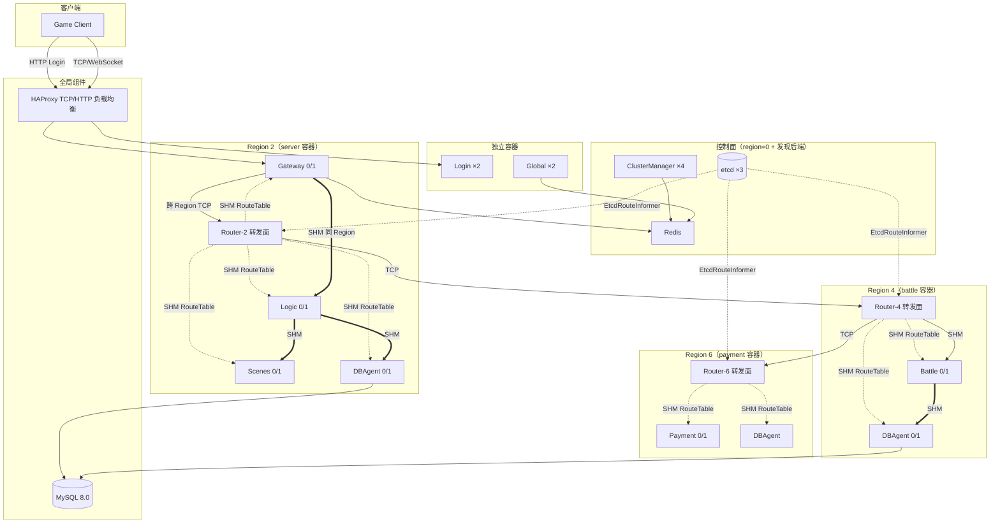
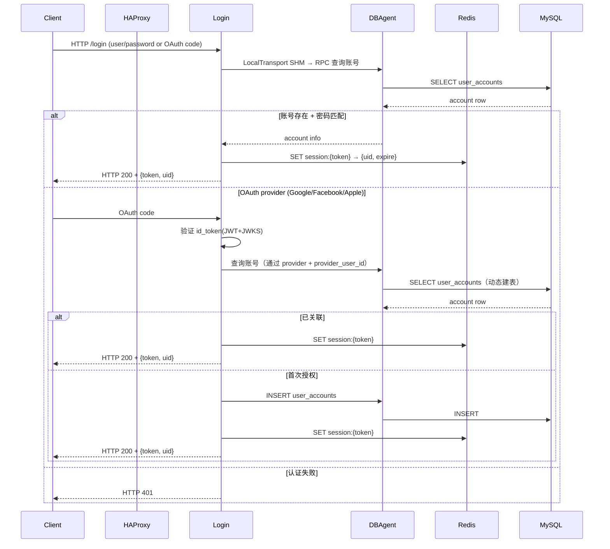
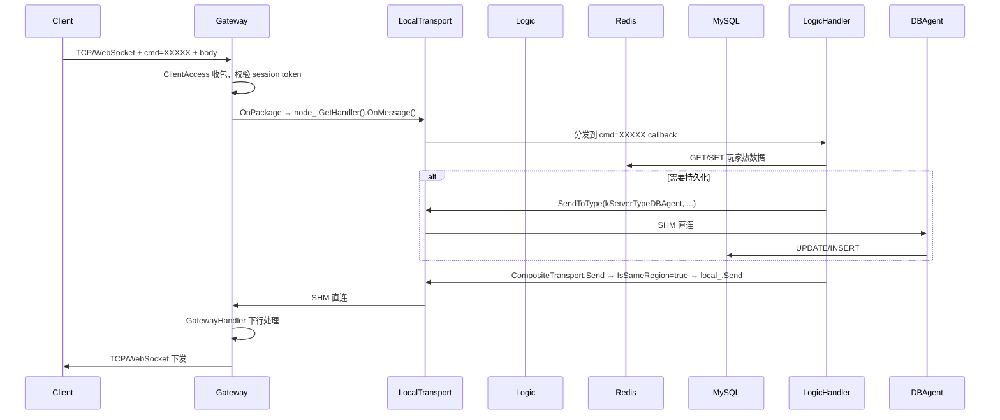
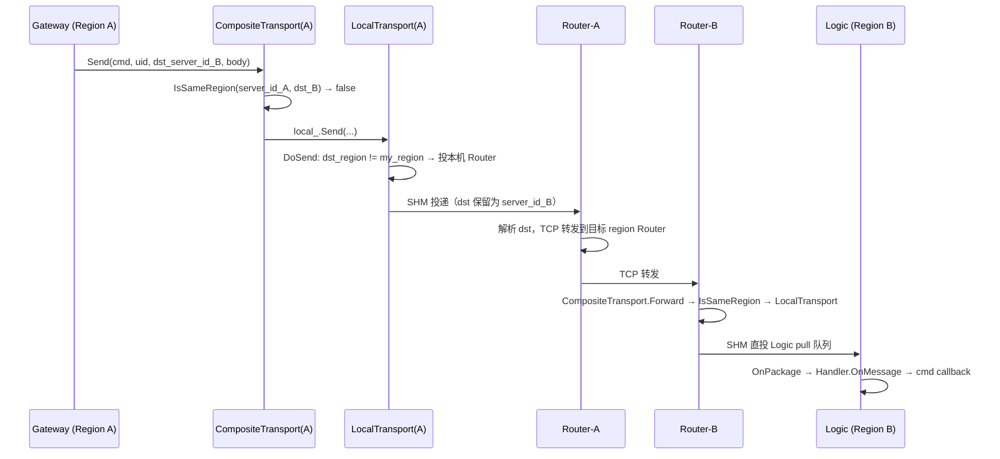
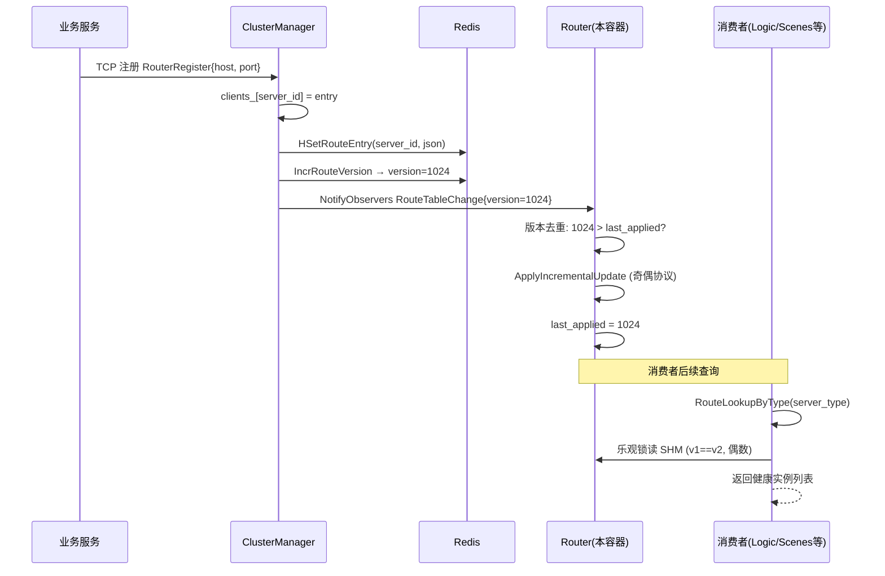
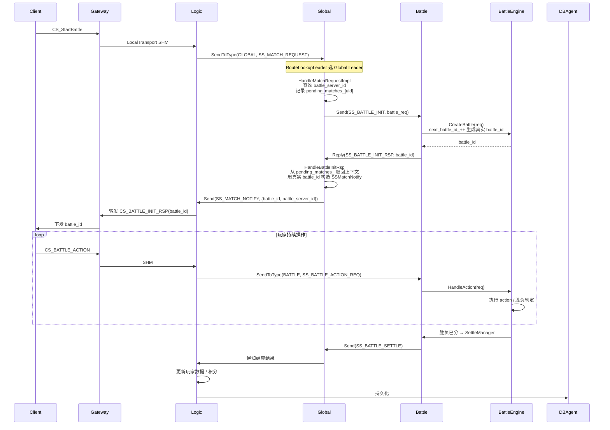
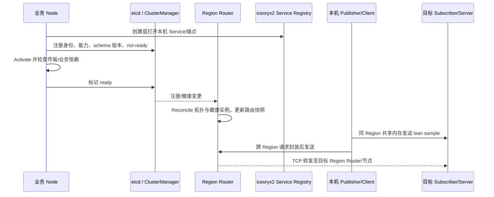

# 分布式游戏服务器集群 —— 架构设计

本文档定义 NimbusCluster 分布式游戏服务器集群的目标架构、节点职责、通信机制、生命周期、服务发现、数据存储、部署和兼容性约束。核心设计由 **节点生命周期 + 显式通信语义 + iceoryx2 本机零拷贝数据面 + Router 跨 Region 转发面** 组成。

## 目录

1. [项目定位与约束](#1-项目定位与约束)
2. [架构全景](#2-架构全景)
3. [服务节点详解](#3-服务节点详解)
4. [通信架构](#4-通信架构)
5. [服务发现与路由表分发](#5-服务发现与路由表分发)
6. [核心流程](#6-核心流程)
7. [数据存储设计](#7-数据存储设计)
8. [关键设计模式](#8-关键设计模式)
9. [部署架构](#9-部署架构)
10. [节点运行模型与通信契约](#10-节点运行模型与通信契约)

---

## 1. 项目定位与约束

### 1.1 项目定位

NimbusCluster 是一个 **进程化微服务** 的 C++17 游戏服务器集群。框架将典型 MOBA / MMORPG 所需的能力拆分为 **10 种服务节点类型**，通过 `server_id` 高 16 位（Region）区分物理容器，同 Region 使用 iceoryx2 发布/订阅或请求/响应服务实现共享内存 IPC，跨 Region 由 LocalTransport 自动投递到本机 Router，经 Router TCP 转发到目标 Region。

**路由表分发**采用双模式服务发现 → Router SHM 架构。`discovery.mode=etcd` 时：业务实例经 `EtcdRegistrar` lease 自注册，Router 由 `EtcdRouteInformer` 同步（GetPrefix 全量快照 → Watch 事件）+ `RouteReconciler` 展开路由，经奇偶协议写本机 SHM 路由表。`discovery.mode=cm`/空时：CM（ClusterManager）将注册信息写入 Redis（HSET + INCR 全局版本号），经观察者模式 TCP 通知各 Region Router（RouterObserver），Router 同样以奇偶协议更新 SHM。两种模式下消费者均通过 atomic 版本号乐观锁读取 SHM 路由表。

业务层通过 **INode 中介者 + CompositeTransport + MessageHandler** 三件套与底层通信完全解耦，业务服务开发者只需注册 cmd 处理器，无需关心底层走 SHM 还是 TCP。

### 1.2 主要技术约束

| 约束 | 说明 |
|------|------|
| C++17 单体仓库 | 所有服务共用一份 CMake 顶层，减少构建复杂度 |
| Boost.Asio 单线程 io_context | 每个服务实例 1 个 io_context，多实例并行，避免共享状态 |
| Protobuf + gRPC | 统一消息编码；gRPC 仅用于跨语言接口预留，内部 RPC 走 SHM/TCP |
| iceoryx2 Service 命名 | `nimbus/<env>/<region>/<service>/<pattern>/<schema>`，按消息契约创建本机端点 |
| Redis + MySQL | Redis 做热数据/排行榜/路由表存储，MySQL 做持久化存储 |
| 10 种服务节点固定集 | Router / Gateway / Login / DBAgent / Logic / Scenes / Global / Battle / ClusterManager / Payment，由 `protocol::ServerType` 枚举统一管理（`PAYMENT = 10`，`clustermanager` 配置字段号 10 对应 `type: 9`） |
| ServerID 编码规则 | `uint32_t server_id = ((region << 16) & 0xFFFF0000) \| ((type << 8) & 0x0000FF00) \| (index & 0x000000FF)`；例：Region 2 + Logic(5) + index 0 = 0x00020500 |

### 1.3 通信架构概览

| 场景 | 协议/通道 | 说明 |
|------|-----------|------|
| 客户端 → Gateway | TCP / WebSocket | HAProxy 前置 TCP 负载均衡；Login 走 HTTP 重定向登录 |
| 服务 → 服务（同 region） | **iceoryx2**（本机共享内存 Publish-Subscribe / Request-Response） | LocalTransport 通过 iceoryx2 Service 直达目标进程，不经应用层中转 |
| 服务 → 服务（跨 region） | **LocalTransport → 本机 Router SHM → TCP → 目标 region Router → SHM** | 业务无感自动路由：LocalTransport::DoSend 检测 dst_region != my_region 时自动投本机 Router |
| Gateway → Logic → DBAgent | SHM（同 Region） | 典型热路径，走 LocalTransport（同 Region iceoryx2） |
| 服务实例注册 | **etcd（EtcdRegistrar lease 自注册）或 CM（TCP RouterRegister）** | `discovery.mode=etcd` 时实例经 lease 保活上报，宕机自动摘除；`cm` 时经 CM 注册 |
| 路由表分发 | **etcd 模式：Router 的 EtcdRouteInformer 监听 etcd → RouteReconciler（拓扑×在线实例）→ SHM 奇偶协议写入；cm 模式：CM（Redis HSET+INCR）→ 观察者 TCP 通知 → Router → SHM** | 两种模式都写同一张本机 SHM 路由表；消费者通过 `RouteLookupByType`/`RouteLookupLeader` 乐观锁读取 |
| Login → DBAgent | SHM（同 Region）或 TCP（跨 Region） | OAuth 三提供商账号校验 |
| Global → Battle | LocalTransport（跨 Region 经 Router） | 战斗匹配分配、结算通知 |
| 客户端 → Payment | HTTP（商家回调 + 查询） | 支持 Google Play / Paddle / XorPay / Mock 渠道通知 |
| Logic → Payment | SHM 或 TCP（跨 Region 经 Router） | 创建订单、查询状态、通知发货 |

---

## 2. 架构全景

### 2.1 架构全景图



> 上图简化为业务链路；`discovery.mode` 决定控制面（etcd 模式：实例经 `EtcdRegistrar` 自注册、Router 经 `EtcdRouteInformer`；CM 模式：实例注册到 CM、CM 观察者通知 Router）。

### 2.2 服务节点一览表

| # | 服务类型 | Proto 枚举 | 目录 | 二进制 | 部署 | 核心职责 |
|---|---------|-----------|------|--------|------|---------|
| 0 | **ClusterManager** | `CLUSTER_MANAGER = 9` | `clustermanager` | 独立进程 ×4 | CM 容器 | **控制面（CM 模式）**：服务注册、心跳检测、Redis 路由表持久化（HSET+INCR version）、观察者通知（TCP 推送 RouteTableChange）；`discovery.mode=etcd` 时被跳过，发现由 etcd 承担；直接继承 TcpServer，不使用 ITransport 抽象 |
| 1 | **Router** | `ROUTER = 1` | `router` | 每 Region ×1（region=0 除外） | 各业务容器 | **转发面 + SHM 路由表维护**：按 `discovery.mode` 从 etcd（EtcdRouteInformer）或 CM（RouterObserver 观察者通知）获取实例 → RouteReconciler（拓扑×在线实例）→ SHM 奇偶协议写路由表；跨 Region TCP 转发；本容器业务进程只读该 SHM；唯一使用 CompositeTransport 的既有服务（业务经 ITransport 中介） |
| 2 | Gateway | `GATEWAY = 2` | `gateway` | server 容器 ×2 | server | 玩家 TCP/WebSocket 接入、心跳、uid↔session 映射、CS 下行拦截器 |
| 3 | Login | `LOGIN = 3` | `login` | login 容器 ×2 | login | HTTP 注册/登录、OAuth 2.0（Google/Facebook/Apple）、token/session 分发 |
| 4 | DBAgent | `DB_AGENT = 4` | `dbagent` | server ×2 + battle ×2 + global ×2 + login ×2 + payment ×2 | 各业务容器 | MySQL 访问代理、动态建表、读写 RPC |
| 5 | Logic | `LOGIC = 5` | `logic` | server 容器 ×2 | server | 玩家状态、会话验证、核心业务、GM 命令 |
| 6 | Scenes | `SCENES = 6` | `scenes` | server 容器 ×2 | server | 场景/地图/房间、位置同步 |
| 7 | Global | `GLOBAL = 7` | `global` | global 容器 ×2 | global | **全局协调**：在线统计、排行榜、全服广播、战斗匹配队列；Leader 顺位选举（`instance_id` 最小者，经 `RouteLookupLeader`） |
| 8 | Battle | `BATTLE = 8` | `battle` | battle 容器 ×2 | battle | 战斗引擎：BattleInstance、BattleRule、SettleManager、StatsManager |
| 9 | **Payment** | `PAYMENT = 10` | `payment` | payment 容器 ×2 | payment 容器 | **支付服务**：桥接装配（transport → ProviderRegistry → OrderStore/OrderManager → PaymentHandler/PaymentHttpHandler）、订单状态机、渠道适配（Google/Paddle/XorPay/Mock）、Redis 存储、发货通知 Logic、HTTP 回调入口 |

### 2.3 部署拓扑

单台主机的典型部署：

```text
Host 1（clustermanager 容器，region=0）
├── ClusterManager  ×4   (cm 0..3，CM 模式控制面；etcd 模式下被跳过)

Host 2（login 容器，region=1）
├── etcd           ×3  (发现后端，独立平台组件)
├── Redis          (路由表持久化 / 热数据)
├── Router         ×2   (index0/1 双活：转发 + CAS 互斥写表)
├── Login          ×2
└── DBAgent        ×2

Host 3（server 容器，region=2）
├── Router         ×2   (index0/1 双活：转发 + CAS 互斥写表)
├── DBAgent        ×2
├── Gateway        ×2
├── Scenes         ×2
└── Logic          ×2

Host 4（global 容器，region=3）
├── Router         ×2   (index0/1 双活：转发 + CAS 互斥写表)
├── Global         ×2
└── DBAgent        ×2

Host 5（battle 容器，region=4）
├── Router         ×2   (index0/1 双活：转发 + CAS 互斥写表)
├── DBAgent        ×2
└── Battle         ×2

Host 6（payment 容器，region=6）
├── Router         ×2   (index0/1 双活：转发 + CAS 互斥写表)
├── Payment        ×2
└── DBAgent        ×2

全局组件：HAProxy（TCP/HTTP 负载均衡）、MySQL 8.0（持久化）
```

Router 在每个业务容器中维护本机 SHM 路由表，同容器内所有业务进程通过 `ServiceBase::RouteLookupByType` / `RouteLookupLeader` 以乐观锁读取。`discovery` 配置（`discovery.mode=etcd/cm`）决定控制面来源。

---

## 3. 服务节点详解

### 3.1 ClusterManager（CM，控制面，×4，CM 模式）

ClusterManager 是集群在 **CM 模式下的唯一控制面**，负责服务注册、心跳检测、Redis 路由表持久化、观察者通知；`discovery.mode=etcd` 时 CM 被跳过，其职责由 etcd（`EtcdRegistrar` 自注册 + Router 侧 `EtcdRouteInformer`）承担。CM 不转发任何业务数据包。

#### 核心职责

| 维度 | 职责 |
|------|------|
| **服务注册** | 业务进程 TCP 连接 CM 后发送 `RouterRegister{host, port}`，CM 从 `package->src()` 获取 `server_id`，推导 `server_type`/`region`/`instance_id`，存入 `clients_` 内存表 |
| **Redis 持久化** | `redis.HSetRouteEntry(pb_entry)` + `version = redis.IncrRouteVersion()`，保证多 CM 实例幂等（HSET 覆盖写同一 key） |
| **心跳检测** | CM 通过层级时间轮（TimerWheel）管理心跳超时（15s 超时，3s 探测间隔）；超时标记 `healthy=false`，触发 Redis 更新 + 观察者通知 |
| **观察者通知** | CM 维护 `observers_`（所有 Region 的 Router 连接），注册变更时通过 TCP 推送 `RouteTableChange{event_type, server_id, ..., version}` |
| **全量同步** | Router 启动注册为观察者或 SHM 脏状态检测时，CM 回复 `RouteTableFullSync`（含当前所有注册条目和版本号） |
| **启动恢复** | CM 启动时 `HGetAllRouteEntries` 从 Redis 全量恢复 `clients_` 内存表 |

#### CM → Router 通知流程

```text
CM 收到注册（OnRegister）：
  1. clients_[server_id] = entry                 // 内存表
  2. redis.HSetRouteEntry(pb_entry)              // Redis 持久化
  3. version = redis.IncrRouteVersion()          // 全局递增版本号
  4. NotifyObservers("register", entry, version) // TCP 推送所有 Router

CM 检测断线（OnDisconnect）：
  1. entry = clients_[server_id]                  // 保存
  2. clients_.erase(server_id)                    // 清理内存
  3. redis.HDelRouteEntry(server_id)             // 清理 Redis
  4. version = redis.IncrRouteVersion()
  5. NotifyObservers("unregister", entry, version)
```

#### 幂等性保障（两层模型）

| 层 | 职责 | 机制 | 效果 |
|----|------|------|------|
| CM → Redis | 多 CM 同时写不冲突 | `HSET` 覆盖写 + `INCR` 原子递增 | 全局有序 |
| Router 去重 | 过滤 4 个 CM 重复通知 | `notify_version > last_applied` 比较 | 1 次注册仅 1 次 SHM 更新 |

### 3.2 Router（转发面 + SHM 路由表维护，每 Region ×2，region=0 除外）

Router 在每个业务容器中承担双重职责：跨 Region TCP 转发 + 本机 SHM 路由表维护。每 Region 部署 **2 个实例**（双活写表，`router <region> <index>` 启动，index 1 端口 = index 0 + 100）：

- **两实例均写表（双活）**：`RouteTableShmWriter` 的每个写操作由 SHM `version` 的 **CAS 互斥**保护——`BeginWrite()` 将偶数 version 用 `compare_exchange` 置脏（奇数），失败/遇奇则自旋；任意时刻至多一个 writer 位于脏区间，因此两个 Router 进程可并发写同一张 Region 表而不撕裂、不破坏奇偶校验。任一实例故障，另一实例继续独立写表（故障转移）。
- **残留脏自愈**：writer 崩溃在脏区间会使 version 停于奇数；`BeginWrite()` 自旋超阈值后由唯一赢家 CAS 复位为偶数，转为常规重建路径，化解读写死锁。
- **只读侧不变**：消费者读偶数版本、奇数重试；双实例写表不改变既有乐观锁读协议。

| 维度 | 职责 |
|------|------|
| **转发面** | 接收本 Region 业务进程通过 SHM 投递的跨 Region 消息，解析 `msg.head.dst`，TCP 转发到目标 Region 的 Router |
| **路由表来源（etcd 模式）** | `EtcdRouteInformer` 起步 `GetPrefix` 全量快照，随后 Watch 增量事件；经 `RouteReconciler`（静态拓扑 × 在线 etcd 实例 → 路由条目）收敛后写 SHM |
| **路由表来源（CM 模式）** | 连接所有 4 个 CM 实例作为观察者，接收 `RouteTableChange` 通知；版本去重（`notify_version > last_applied`）后增量/全量更新 SHM |
| **SHM 写入（奇偶协议）** | `version++(奇数) → 修改数据 → version++(偶数)`；消费者读到奇数版本时重试，防止读到半写数据 |
| **脏状态恢复** | `OnTick()` 检测 SHM version 持续奇数超过阈值 → CM 模式 `SendRawToCM(FULL_SYNC_REQ)` 全量重建；etcd 模式重新 `GetPrefix` 全量快照 |
| **RouterAccess** | TCP Server：接收本 Region 业务进程注册连接（绑定 `server_id → connection`）和 CM 观察者通知；非注册/非通知包走 `transport.Forward` |

#### SHM 路由表结构（Router 写入，消费者只读）

```cpp
// src/common/shm/shm_routetable.h
static constexpr uint32_t kMaxRouteEntries = 256;
static constexpr uint64_t kRouteTableMagic = 0x4E424D535F52544CULL;

#pragma pack(push, 1)
struct RouteTableHeader {
    uint64_t magic = kRouteTableMagic;           // 魔数校验
    ipc::shm::ShmAtomic<uint64_t> version{0};    // 乐观锁版本号（奇数=写入中）
    uint32_t capacity = kMaxRouteEntries;        // 256
    uint32_t entry_count = 0;
    uint64_t last_full_update_ms = 0;
    uint8_t reserved[96] = {};
};  // 128 bytes

struct RouteEntryShm {                        // 固定 88 字节
    uint32_t server_id;
    uint32_t server_type;
    char host[64];                             // 固定长度，无指针
    uint32_t port;
    uint32_t region;
    uint32_t instance_id;
    uint8_t healthy;
    uint8_t reserved[3];
};
#pragma pack(pop)
```

### 3.3 Gateway

Gateway 是玩家接入网关，同时支持 **TCP** 和 **WebSocket** 两种客户端接入方式。

| 项 | 内容 |
|----|------|
| 继承 | `GatewayService : public ServiceBase` |
| ITransport | `LocalTransport`（同 region SHM 直连 + 跨 region 自动投本机 Router） |
| IMessageHandler | `GatewayHandler`（继承 `MessageHandler`） |
| 客户端接入 | `ClientAccess`（TCP 长连接）+ `WebSocketAccess`（WebSocket，独立 IClientAccess 实现） |
| 职责 | uid↔session 映射、心跳超时踢人、CS 下行拦截（GM 命令过滤） |
| CS 下行 | GatewayHandler 直接调用 `SendToClient`，经过 GatewayService 的 ClientAccess/WebSocketAccess 下发 |

### 3.4 Login

Login 提供 HTTP 登录注册 + OAuth 2.0 第三方认证。

| 项 | 内容 |
|----|------|
| 继承 | `LoginService : public ServiceBase` |
| ITransport | `LocalTransport` |
| IMessageHandler | `LoginHandler` |
| HTTP | 内嵌 HttpServer，路由 `/register`、`/login`、`/oauth/google`、`/oauth/facebook`、`/oauth/apple` |
| OAuth | 授权码模式 + JWT 验证；id_token 验签（JWKS endpoint） |
| 数据持久化 | 经 LocalTransport → SHM → DBAgent |
| Token | 签发 JWT access_token + Redis 中 session 记录 |

### 3.5 DBAgent

DBAgent 是 MySQL 统一访问代理，业务服务 **绝不应** 直接持有 mysql-connector 连接。

| 项 | 内容 |
|----|------|
| 继承 | `DBAgentService : public ServiceBase` |
| ITransport | `LocalTransport` |
| IMessageHandler | `DBAgentHandler` |
| MySQL | 每实例一个连接池；动态建表（从 protobuf Descriptor 读取表结构，`GenerateCreateTableSQL` 自动生成 DDL） |
| 数据表 | protobuf message 名即表名；DBAgent 启动时自动 `CREATE TABLE IF NOT EXISTS`（`CreateTable` 方法） |
| 请求分发 | 按 cmd 分发到 DB 请求处理器；写操作串行化保证单请求完整性 |

### 3.6 Logic

Logic 是业务核心。

| 项 | 内容 |
|----|------|
| 继承 | `LogicService : public ServiceBase` |
| ITransport | `LocalTransport` |
| IMessageHandler | `LogicHandler` |
| 玩家数据 | Redis 热数据 + DBAgent 持久化 |
| OnBefore 钩子 | `LogicHandler::OnBefore` 中打开玩家共享内存块（`UserInfoWrap::ShmUserInfo`，`SharedMemory<DBUserInfo>`），为同进程同 region 跨 Logic 实例共享 |
| GM 命令 | cmd 表中注册 GM 命令处理器，支持在线 GM 指令下发 |
| CS 路径 | Gateway → LocalTransport(SHM) → LogicHandler → OnMessage → 业务处理 → LocalTransport.Send(SHM) → Gateway → ClientAccess |

### 3.7 Battle

Battle 是独立战斗服务，承担完整的战斗引擎职责。

| 项 | 内容 |
|----|------|
| 继承 | `BattleService : public ServiceBase` |
| ITransport | `LocalTransport` |
| IMessageHandler | `BattleHandler` |
| 核心组件 | `BattleEngine`（工厂 + 注册表）、`BattleInstance`（单场战斗状态）、`BattleRule`（胜负判定规则）、`SettleManager`（结算分发）、`StatsManager`（战报统计） |
| BattleEngine | `CreateBattle(SSBattleInitReq)` → 生成 `battle_id`（`next_battle_id_++`）→ 注册到 map；`OnTick()` 推进所有活跃 BattleInstance；`HandleAction(SSBattleActionReq)` 处理玩家操作 |
| 跨语言接口 | `battlerpc.proto` 预留 gRPC 接口，供 Python / Go 活动服调用 |
| 容器 | 独立 `docker/battle/docker-compose.yml`；启动脚本 `start_battle.sh`：router×2 + dbagent×2 + battle×2 |
| 与 Logic 协作 | 战斗开始由 Logic → Global（匹配分配）→ Battle 发起；结算结果 Battle → Global → Logic |

### 3.8 Scenes

| 项 | 内容 |
|----|------|
| 继承 | `ScenesService : public ServiceBase` |
| ITransport | `LocalTransport` |
| IMessageHandler | `ScenesHandler` |
| 职责 | 场景、地图、房间/大厅、位置广播；gRPC 预留 Scenes 跨语言接口 |

### 3.9 Global —— 固定顺位 Leader 选举

Global 是集群的 **全局协调层**，负责在线统计、排行榜、全服广播、战斗匹配队列。Global 采用 **Leader-Follower 多实例部署**，**Leader 由 SHM 路由表中的 `instance_id` 最小者担任**——纯确定性计算，无需分布式锁、无需选举动作、无需 host_id/rank 配置。

#### 核心职责

| 项 | 内容 |
|----|------|
| 继承 | `GlobalService : public ServiceBase` |
| ITransport | `LocalTransport`（同 Region SHM + 跨 Region 经本机 Router） |
| IMessageHandler | `GlobalHandler` |
| 在线统计 | 各 Logic 实例上报在线人数，Global 汇总 |
| 排行榜 | `HandleRankingUpdate` / `HandleGetRanking` |
| 全服广播 | `HandleBroadcastRequest` / `HandleGetBroadcast` |
| GM 命令 | `HandleGmCommand` |
| 战斗匹配队列 | `HandleMatchRequest` / `HandleBattleInitRsp`（匹配队列管理 + Battle 实例分配） |
| Battle 结果通知 | `HandleBattleInitRsp`（接收 Battle 初始化响应，回 `SS_MATCH_NOTIFY` 给 Logic） |

#### Leader 选举：固定顺位计算（`instance_id` 最小者）

**Leader 不是"选"出来的，而是"算"出来的。** 所有进程（Global 自身、Logic、Scenes、Gateway）通过 `INode::RouteLookupLeader(server_type)` 从 SHM 路由表读取同类型所有健康实例，取 `instance_id` 最小者为 Leader：

```cpp
// ServiceBase::RouteLookupLeader（src/common/foundation/servicebase.cpp）
uint32_t ServiceBase::RouteLookupLeader(uint32_t server_type) const
{
    // 乐观锁读取 SHM
    for (int retry = 0; retry < 3; ++retry)
    {
        uint64_t v1 = hdr->version.load(std::memory_order_acquire);
        if (v1 & 1) continue;  // 奇数：写入中，重试

        // 收集所有 healthy 的指定类型实例，取 instance_id 最小者
        uint32_t leader_id = 0;
        uint32_t min_instance_id = 0xFFFFFFFF;
        for (uint32_t i = 0; i < count; ++i)
        {
            if (entries[i].server_type == server_type && entries[i].healthy)
            {
                uint32_t instance_id = entries[i].instance_id;
                if (instance_id < min_instance_id)
                {
                    min_instance_id = instance_id;
                    leader_id = entries[i].server_id;
                }
            }
        }

        uint64_t v2 = hdr->version.load(std::memory_order_acquire);
        if (v1 == v2) return leader_id;  // 版本稳定，数据一致
    }
    return 0;
}
```

#### Global 自身 Leader 判断

```cpp
// GlobalService（src/global/globalservice.cpp）
bool GlobalService::IsLeader() const
{
    uint32_t leader_id = RouteLookupLeader(kGlobalServerType);
    return (leader_id == server_id());
}

void GlobalService::UpdateLeaderState()
{
    bool is_leader = IsLeader();
    if (is_leader && !was_leader_) {
        // BECOME LEADER：执行接管逻辑
    } else if (!is_leader && was_leader_) {
        // LOST LEADER：执行退让逻辑
    }
    was_leader_ = is_leader;
}

int GlobalService::OnTick()
{
    UpdateLeaderState();  // 每 tick 检查 Leader 状态
    return 0;
}
```

#### 消息路由

**发送方（Logic/Scenes → Global）**：`LocalTransport::SendToType` / `AsyncRequest` 对 `GLOBAL` 类型特殊处理，使用 `RouteLookupLeader` 选择 Leader 实例：

```cpp
// localtransport.cpp
if (server_type == protocol::ServerType::GLOBAL)
    dst_server_id = node_.RouteLookupLeader(server_type);
else
    dst_server_id = node_.RouteLookupByType(server_type);
```

**接收方（Global Follower 拒绝请求）**：`GlobalHandler::OnBefore` 检查 Leader 状态，非 Leader 回复 `RESULT_NOT_LEADER`：

```cpp
bool GlobalHandler::OnBefore(UserId uid, const ipc::PackagePtr& pkg)
{
    auto* global_service = dynamic_cast<GlobalService*>(&node_);
    if (!global_service->IsLeader())
    {
        ReplyFail(pkg->cmd(), uid, pkg->src(), protocol::RESULT_NOT_LEADER, pkg->request_id());
        return false;  // 阻止业务 handler 执行
    }
    return true;
}
```

#### 故障切换

```
Global-1 (instance_id=0, Leader) 宕机
  │
  ├─ CM 心跳超时（15s）→ healthy=false
  ├─ CM HSetRouteEntry + IncrRouteVersion → NotifyObservers("health_change")
  ├─ Router-3 收到通知 → SHM 更新：Global-1 healthy=0
  │
  ├─ Logic 下次 SendToType(GLOBAL) → RouteLookupLeader
  │     └─ 读 SHM → [Global-1 healthy=0, Global-2 healthy=1]
  │     └─ instance_id 最小 → Global-2 (instance_id=1) 成为新 Leader
  │
  └─ Global-2 自身 OnTick → UpdateLeaderState()
        └─ IsLeader() = true → BECOME LEADER
```

**切换延迟**：CM 心跳超时（15s）+ Router SHM 更新（毫秒级）+ 消费者下次读取（即时）+ Global 自身检测（下一个 OnTick）。总延迟主要由 CM 心跳超时决定。

#### Global 与 Battle 的职责分工

| 服务 | 职责 | 说明 |
|------|------|------|
| **Global（全局协调）** | 匹配队列、排行榜、全服广播、Battle 实例分配 | 决策"谁和谁打"以及"在哪台 Battle 上打"；Leader-Follower 保证协调层高可用 |
| **Battle（战斗引擎）** | 执行具体战斗逻辑 | BattleInstance + BattleRule + SettleManager + StatsManager |

### 3.10 Payment（支付服务，×2）

Payment 是独立于业务逻辑的支付服务（`PAYMENT = 10`，独立 region=6 容器），以 **Bridge** 桥接模式装配各支付组件：

```text
transport(ServiceBase) → ProviderRegistry → OrderStore/OrderManager → PaymentHandler/PaymentHttpHandler
```

| 维度 | 职责 |
|------|------|
| **OrderManager（订单状态机）** | 核心状态机（CREATED / PENDING / CONFIRMED / DELIVERED / FAILED / REFUNDED 等），管理订单生命周期 |
| **ProviderRegistry（渠道路由）** | 按渠道类型注册并路由到具体 Provider：Google、Paddle、XorPay、Mock |
| **渠道适配** | Google：Play Billing 验签（OAuth 兑换 code→token）+ 权限校验；Paddle：salt + `{{paddle_signature}}` HMAC 验签；XorPay：XorPay 回调校验；Mock：单元测试/联调用，跳过外部依赖 |
| **OrderStore（订单存储）** | `RedisOrderStore`：订单以 hash 存 Redis，支持 `order_prefix + key` 定位；Mock 内存实现 |
| **发货通知** | 校验通过后先生成订单号，再向 Logic 服务发送发货/入账指令（走 LogicHandler 渠道） |
| **HTTP 回调入口** | `PaymentHttpHandler` 接收各渠道异步回调（Google/Paddle/XorPay），校验签名后入库并触发发货 |
| **与 Logic 的交互** | Logic 负责创建订单请求、发货路由（`PaymentProto` 消息 + `route` 字段） |

---

## 4. 通信架构

### 4.1 通信分层

```text
业务 Service / MessageHandler
          │ ITransport
          ▼
   CompositeTransport
      ┌───┴──────────────┐
      │                  │
同机目标              跨 Region 目标
LocalTransport        RemoteTransport
      │                  │
iceoryx2 Node/Service  本机 Router → TCP → 目标 Router
      │                  │
iceoryx2 SHM Service   目标端 LocalTransport
```

`ITransport` 隔离业务服务与传输实现。`CompositeTransport` 以目标 Region 选择本机共享内存或跨 Region TCP；路由表只用于目标解析和健康过滤。iceoryx2 管理同机 Service 发现与样本传递，etcd/CM 管理集群节点注册和 Region 路由，两者职责分离。

### 4.2 通信模式与消息契约

| 模式 | 用途 | 本机承载 | 跨 Region 承载 |
|---|---|---|---|
| Publish-Subscribe | 可广播事件、状态通知 | iceoryx2 Publisher/Subscriber | Router/TCP 事件 envelope |
| Request-Response | 定向命令、查询 | iceoryx2 Client/Server | Router/TCP 请求/响应 envelope |
| Event | 线程唤醒和状态提示 | iceoryx2 Event 或运行时通知 | Router 控制消息；不承载可靠业务数据 |
| 客户端下行 | 服务端向玩家连接发送 | Gateway ClientAccess/WebSocketAccess | Gateway 外部连接 |

每条通道声明 service name、pattern、schema_id/version、最大样本尺寸、端点上限、队列深度、deadline、可靠性和溢出策略。启动时检查底层配置是否支持所声明语义，不支持则配置失败。request/response 使用 request_id、deadline、错误码和幂等键；广播事件不承担唯一目标确认。

### 4.3 Iceoryx2Transport

`Iceoryx2Transport` 封装 iceoryx2 C++ binding，管理进程级 Node 和通道级 Service/端点。发布端对共享内存样本 loan，在样本内写入固定布局 envelope 与 POD payload 后 send；接收端 receive 只读样本，完成 Handler 后由 RAII 句柄释放。`IMessageHandler` 只接收 Nimbus envelope/Payload view，不接触第三方 sample 类型。

Payload 采用标准布局、固定宽度字段，不包含进程私有指针、普通动态容器或裸 Protobuf 对象。Protobuf 继续用于网络 schema 和非热点业务；同机传输避免额外的完整 Payload 复制，但边界转换仍可能复制，因此不定义为端到端零拷贝。

### 4.4 RemoteTransport 与 Router

目标 Region 与本机不同，`RemoteTransport` 将 Protobuf 网络 envelope 发送到本机 Router。Router 按版本化路由视图选目标 Region Router，经 TCP 转发；目标端将消息交给对应业务服务。跨机消息不包含共享内存地址、句柄或本机 ABI 数据。request_id 在两端 Transport 维护映射，网络断连或 deadline 到期返回统一错误。

### 4.5 错误、背压与可观测性

传输错误统一为 `NoService`、`IncompatibleSchema`、`LoanExhausted`、`QueueFull`、`DeadlineExceeded`、`PeerUnavailable`、`Stopped`。每条通道使用有限容量；满载时依声明拒绝或丢弃并记录计数，不允许无界内存增长。关键指标包括发送/接收数、P50/P95/P99、样本 loan 失败、队列积压、丢弃/拒绝、request timeout、端点重建和样本持有时长。
## 5. 服务发现与路由表分发

服务发现由 `discovery_cfg.mode`（`localconf.pbtxt` 中的 `discovery.mode`）全局门控，两种模式写同一张本机 SHM 路由表，消费者侧完全一致（`RouteLookupByType` / `RouteLookupLeader`）：

| 模式 | `discovery.mode` | 注册方 | Router 侧 | 权威存储 |
|------|------------------|--------|-----------|---------|
| **etcd（生产推荐）** | `etcd` | 业务实例 `EtcdRegistrar` lease 自注册（宕机自动摘除） | `EtcdRouteInformer`：GetPrefix 全量快照 + Watch 增量 → RouteReconciler（静态拓扑×在线实例）→ SHM | etcd（按 `watch_prefix` 分前缀的 InstanceInfo 键值对） |
| **CM（兼容）** | `cm`/空 | 业务实例 TCP 连 CM 发 `RouterRegister` | `RouterObserver`：收 CM 观察者通知 → 增量/全量更新 SHM | CM `clients_` 内存表 + Redis 持久化 |

`EtcdRegistrar` / `EtcdRouteInformer` 均位于 `src/common/discovery/`；自此之后的 5.1→5.7 小节详细描述 CM 模式控制面的数据流，etcd 模式的对应实现见 5.8。

### 5.1 总体架构（CM 模式）

路由表分发采用 **CM 控制面 → Redis 持久化 → 观察者通知 → Router SHM 奇偶协议 → 消费者乐观锁读取** 的分层架构：

```
服务注册/反注册/健康变化
  │
  ▼
CM（控制面，×4）
  ├─ clients_ 内存表（server_id → RouterEntry）
  ├─ Redis HSetRouteEntry / HDelRouteEntry
  ├─ Redis IncrRouteVersion（全局单调递增版本号）
  └─ NotifyObservers(RouteTableChange{version})
         │
         ▼ TCP 通知
各 Region 的 Router
  ├─ 版本去重：notify_version > last_applied
  ├─ 增量更新 SHM（register/unregister/health_change）
  │   或全量重建 SHM（FullSync）
  ├─ SHM 奇偶协议：version++(奇) → 写入 → version++(偶)
  └─ last_applied = notify_version
         │
         ▼ SHM 路由表（同容器只读）
消费者（Logic/Scenes/Gateway/Battle/Global）
  └─ ServiceBase::RouteLookupByType / RouteLookupLeader
     乐观锁读取（load(acquire) × 2 + compare，奇数重试）
```

### 5.2 注册协议

服务通过 `SS_MSG_CMD_ROUTER_REGISTER` 向 CM 上报：

| 字段 | 类型 | 来源 | 说明 |
|------|------|------|------|
| `server_id` | uint32 | `PackageHead.src` | 服务唯一标识 |
| `host` | string | `RouterRegister.host` | 服务监听地址 |
| `port` | uint32 | `RouterRegister.port` | 服务监听端口 |

**CM 派生字段**（从 server_id 解码）：

| 字段 | 推导方式 |
|------|---------|
| `server_type` | `(server_id >> 8) & 0xFF` |
| `region` | `server_id >> 16` |
| `instance_id` | `server_id & 0xFF` |

### 5.3 观察者协议

Router 连接 CM 后发送 `SS_MSG_CMD_ROUTER_OBSERVER_REGISTER`，CM 将其加入 `observers_` 列表。注册变更时 CM 推送：

```protobuf
message RouteTableChange {
    string event_type = 1;   // "register" / "unregister" / "health_change"
    uint32 server_id = 2;
    uint32 server_type = 3;
    string host = 4;
    uint32 port = 5;
    uint32 region = 6;
    uint32 instance_id = 7;
    bool healthy = 8;
    uint64 version = 9;     // Redis 全局版本号（Router 去重用）
}
```

### 5.4 Router SHM 更新（奇偶协议）

Router 收到通知后，通过奇偶协议保证 SHM 写入的原子性：

```cpp
void ApplyIncrementalUpdate(const RouteEntryShm& entry, const std::string& event_type)
{
    uint64_t write_ver = header->version.load(acquire);
    header->version.store(write_ver + 1, release);  // 奇数：写入中

    if (event_type == "unregister") {
        // swap-pop 删除条目
    } else {  // register / health_change
        // 新增或更新条目
    }

    header->version.store(write_ver + 2, release);  // 偶数：完成
}
```

**版本去重**：`notify_version <= last_applied` 时跳过，防止 4 个 CM 重复通知导致多次 SHM 更新。

### 5.5 消费者乐观锁读取

消费者通过 `ServiceBase::RouteLookupByType` / `RouteLookupLeader` 读取 SHM 路由表：

```cpp
for (int retry = 0; retry < 3; ++retry)
{
    uint64_t v1 = hdr->version.load(acquire);
    if (v1 & 1) continue;  // 奇数：脏状态，重试

    // 读取 entries...

    uint64_t v2 = hdr->version.load(acquire);
    if (v1 == v2) return result;  // 版本稳定，数据一致
}
return 0;  // 重试失败，返回 0（调用方降级到静态配置）
```

### 5.6 脏状态检测与全量恢复

Router 的 `OnTick()` 周期性检测 SHM version 是否持续为奇数（写入中崩溃）：

```
RouterService::OnTick:
  每 kDirtyDetectIntervalTicks 次 tick:
    if (RouterObserver::IsShmDirty()):   // version % 2 == 1
      dirty_detect_count_++
      if (dirty_detect_count_ >= kDirtyDetectThreshold):
        SendFullSyncReq()                 // SendRawToCM(FULL_SYNC_REQ)
        dirty_detect_count_ = 0

CM::OnFullSyncReq:
  验证请求者为已注册观察者
  SendFullSync(RouteTableFullSync{entries, version})

RouterObserver::OnRouteTableFullSync:
  WriteFullTable(entries)   // 全量重建 SHM
  last_applied = sync.version
```

### 5.7 幂等性保障（四层模型）

| 层 | 职责 | 组件 | 机制 | 效果 |
|----|------|------|------|------|
| **第 1 层：CM 全局幂等** | 多 CM 多主机同时写不冲突 | CM → Redis | `HSET` 覆盖写同一 server_id + `INCR` 原子递增 | 全局有序、数据一致 |
| **第 2 层：Router 去重幂等** | 过滤 4 个 CM 的重复通知 | Router | `notify_version > last_applied` 比较 | 1 次注册仅 1 次 SHM 更新 |
| 第 3 层：SHM 写入幂等 | 单次 SHM 写不产生脏数据 | Router → SHM | 奇偶协议：奇数=写入中，偶数=稳定 | 崩溃后消费者不读脏数据 |
| 第 4 层：SHM 读取幂等 | 消费者读一致性 | 消费者 → SHM | `load(acquire) × 2 + compare`，奇数重试 | 版本稳定才消费 |

### 5.8 服务发现（etcd 模式）

当 `discovery.mode=etcd` 时，控制面由 etcd 承担，CM 与 CM 观察者全链路跳过：

```text
业务实例（EtcdRegistrar，src/common/discovery/etcdregistrar.[h|cpp]）
  LeaseGrant(lease_ttl_sec) → PutIfAbsent(key, InstanceInfo, lease) → LeaseKeepAliveLoop
  宕机：lease 过期 → etcd 自动删除条目（无需显式注销）
  优雅退出：LeaseRevoke 主动摘除
        │  key = <watch_prefix><region>/<server_type>/<index>（前缀默认以 / 结尾，
        │      如 /nimbus/discovery/instances/2/5/0）
        ▼
etcd（权威存储，按 watch_prefix 隔离）
        │
        ▼
Router 侧 EtcdRouteInformer（src/common/discovery/etcdrouteinformer）
  起步 GetPrefix(watch_prefix)：全量快照 → InstanceInfo 解码
  常驻 Watch：增量 PUT/DELETE 事件（支持 fake 事件源便于单测）
        │
        ▼
RouteReconciler（拓扑 × 在线实例 → 路由条目展开）
  - 已定义于 topology.pbtxt 且 etcd 中有在线实例的 → 生成路由条目
  - 仅在 etcd 注册但拓扑未声明 → 忽略（防御性）
  - 仅在拓扑声明但实例下线 → 标记不可达
        │
        ▼
SHM 路由表（奇偶协议写入，消费者乐观锁读取，与 CM 模式一致）
```

关键组件（均位于 `src/common/discovery/`）：

| 组件 | 职责 |
|------|------|
| `EtcdRegistrar` | 业务实例自注册：LeaseGrant → PutIfAbsent → LeaseKeepAliveLoop；异常时自动重挂 |
| `EtcdRouteInformer` | Router 侧事件源：自有线程循环，GetPrefix 全量快照 + Watch 增量事件 → Reconcile → 写 SHM |
| `IEtcdSource` | 抽象事件源接口，生产实现（gRPC 真实 etcd）与测试 Fake 可替换 |
| `RouteReconciler` | 静态拓扑 × 在线实例 → 路由条目展开（etcd 与拓扑取交集） |
| `InstanceInfo` | 实例注册条目结构（region/type/index/name/pod_ip/ready/version），key 编解码 |

`ServiceBase::InitCMTransport()` 读 `discovery_cfg.mode=="etcd"` 时创建 `EtcdRegistrar` 并跳过 CM transport、改读本机 Router SHM 路由表；Router 侧 `etcd_mode_=(mode=="etcd")` 决定走 `EtcdRouteInformer` 还是 `RouterObserver`。

## 6. 核心流程

### 6.1 登录流程



### 6.2 游戏消息流程



### 6.3 跨 Region 通信流程



### 6.4 服务发现与路由表分发流程



### 6.5 Battle 战斗流程



**Battle 分配关键约束**：
- Global 必须等待 `SS_BATTLE_INIT_RSP` 返回真实 `battle_id` 后，才发送 `SS_MATCH_NOTIFY` 给 Logic
- `SS_MATCH_NOTIFY` 使用 Battle 返回的真实 `battle_id`，而非 uid
- `gateway_id` 必须设置为玩家实际所在 Gateway 的 server_id（从 UserInfo SHM 获取），确保客户端能收到战斗推送

---

## 7. 数据存储设计

### 7.1 MySQL（8.0）

| 表 | 说明 |
|----|------|
| `user_accounts` | 主账号：user_id, username/email, password_hash, salt, created_at |
| `user_profiles` | 玩家资料：user_id → 昵称、头像、创建时间 |
| `user_heroes` | 玩家已拥有英雄列表 |
| `user_items` | 玩家背包/道具 |
| `battle_history` | 战报记录：battle_id, player_ids, winner, scores, duration |
| `global_state` | **Global 主从兜底 checkpoint**：Leader 周期性持久化 match_queue / match_state；Follower 恢复的最后兜底 |

动态建表机制：DBAgent 启动时扫描 protobuf Descriptor，从 `GenerateCreateTableSQL` 自动生成 DDL，若 MySQL 中不存在则自动 `CREATE TABLE IF NOT EXISTS`（`CreateTable` 方法）。表名由 protobuf message 名决定。

### 7.2 Redis

| Key 模式 | 用途 |
|----------|------|
| `session:{token}` | Login 写入，Logic 验证，TTL 默认 24h |
| `player:{uid}` | 玩家热数据（JSON），Logic 读写 |
| `leaderboard:{game_mode}` | `ZSET`，Global/Battle 更新，排行榜查询 |
| `router:servers` | **CM 模式下的在线服务注册表 + 健康权威源**（Hash: server_id → JSON）；Router 通过观察者通知 + 全量同步获取；etcd 模式下由 etcd 承担 |
| `router:version` | **CM 模式的全局单调递增版本号**（Int，INCR）；CM 每次注册变更 INCR，Router 用于去重；etcd 模式下版本由 etcd Watch 事件驱动 |
| `payment:order:{order_id}` | **Payment 订单**（Hash，`RedisOrderStore` 写入）：渠道、金额、状态（订单状态机）、回调数据；支持 `order_prefix + key` 定位 |
| `global:state_snapshot:{version}` | **Global 状态周期快照**（Hash，带递增 version 字段用于乐观锁校验）；新 Leader 接管时取最高版本快照 |

### 7.2b 服务发现存储（etcd 模式）

`discovery_cfg.watch_prefix` 为前缀、以 InstanceInfo 序列化为 value 的键值对（`EtcdRegistrar` 注册 / 天然 lease 过期摘除），Router `EtcdRouteInformer` 通过 GetPrefix + Watch 读取；验证（auth）通过 `discovery_cfg.user/password`、TLS 通过 `ca_file/cert_file/key_file` 配置。

### 7.3 共享内存与路由表

- 同机业务消息由 iceoryx2 管理的 Service、Publisher/Subscriber、Client/Server 和共享内存样本承载；每条通道的容量、样本尺寸和端点数由服务配置定义
- 路由表 SHM：`nimbus_route_table_r{region}`（256KB，`src/common/shm/routetable.h` 的 `RouteTableShmName(region)`；由各 Region Router 创建，同容器业务进程只读；Router 重启时 `open_or_create` 保留既有段、校验失败才删除重建，已 attach 进程不中断）
- iceoryx2 runtime root 与 `/dev/shm` 容量按部署配置统一管理；应用不创建自研消息队列段
- 生产 Docker Compose 设置 `shm_size: 512m`，Battle 容器 `shm_size: 256m`
- **一个容器 = 一台主机**：同机通信节点共享受限 IPC namespace 与 iceoryx2 runtime；跨机不共享 SHM

---

## 8. 关键设计模式

### 8.1 INode 中介者模式（核心抽象）

所有业务 Service 继承 `ServiceBase`（继承 `INode`），提供统一访问点：

```cpp
class INode
{
public:
    virtual ~INode() = default;
    virtual bool Init(const protoconf::ServerItem& cfg) = 0;
    virtual int  OnTick() { return 0; }
    virtual ITransport&      GetTransport() const = 0;
    virtual IMessageHandler& GetHandler()   const = 0;
    constexpr uint32_t server_id() const { return server_id_; }
    boost::asio::io_context& io_context() { return io_context_; }

    // SHM 路由表查询
    virtual uint32_t RouteLookupByType(uint32_t server_type) const { return 0; }
    virtual uint32_t RouteLookupLocalRouter() const { return 0; }
    virtual uint32_t RouteLookupLeader(uint32_t server_type) const { return 0; }
};
```

好处：
- CompositeTransport / LocalTransport / RemoteTransport / MessageHandler 全部通过 `node_` 拿到 server_id、io_context、handler，**消除所有重复状态**
- 业务 Service（GatewayService / BattleService / LoginService ...）只需在 `Init()` 中创建 transport_ + handler_ 并双向注入
- Router 作为集群转发面，同样纳入 ServiceBase 体系

### 8.2 ITransport —— Facade + Strategy + Composite

| 模式 | 体现代码 |
|------|---------|
| Facade | `CompositeTransport` 提供 `Send / SendToType / Broadcast / Forward / AsyncRequest` 统一接口 |
| Strategy | IsSameRegion 运行时决定走 LocalTransport（SHM）还是 RemoteTransport（TCP→Router） |
| Composite | CompositeTransport 内含 local_ 和 remote_ 两个 ITransport 成员，对调用者透明 |

CompositeTransport 的 Forward 路由决策是核心设计点。

### 8.3 IMessageHandler —— 6 步流水线 + 注册表

```cpp
class IMessageHandler
{
public:
    virtual int OnMessage(const PackagePtr& pkg) = 0;
    virtual void RegisterHandler(uint16_t cmd, CmdCallback cb) = 0;
    virtual bool OnBefore(UserId uid, const PackagePtr& pkg) { return true; }
    virtual void OnAfter(int ret, const PackagePtr& pkg) {}
};
```

MessageHandler::OnMessage 内部 6 步流水线：

1. **pkg 空检查**
2. **request_id 匹配**：若 `pkg->request_id() != 0`，由 `ITransport` pending map 完成请求回调并返回（回包不进入业务 cmd handler）
3. **cmd 查表**：`handlers_.find(cmd)`
4. **ParseFromArray**：反序列化 Payload
5. **OnBefore()** → 虚钩子（LogicHandler 打开玩家 SHM；GlobalHandler 检查 Leader）
6. **业务 handler** → 调用 callback → **OnAfter()** → 虚钩子

### 8.4 Singleton 体系

框架中大量使用 Singleton，这些是**进程级**单例，在 `Init()` 阶段创建，生命周期覆盖整个进程：

| 单例 | 职责 |
|------|------|
| `ApplicationSingle` | 主事件循环管理，Run() 阻塞 |
| `ConfigManageSingle` | 本地 + 远程配置加载 |
| `RedisWrapSingle` | Redis 连接池（redis-plus-plus） |
| `LogManageSingle` | glog 初始化 |

### 8.5 Adapter —— RemoteTransport 封装 RpcClient

RemoteTransport 作为底层 TCP 连接（`RpcClient`）和 `ITransport` 接口之间的 Adapter，暴露统一接口，让业务代码无需感知底层是 SHM 还是 TCP。

`RemoteTransport` **不再继承 `ConnectionPool`**，而是内部持有 `RpcClient` 列表（`RpcClient` 继承 `ipc::net::TcpClient`），按目标 region 维护连接映射（`router_by_region_`）。`RpcClient` 负责单连接的 RPC 匹配、超时、断连清理；未匹配的转发包通过 `OnUnhandledPackage` 桥接到 `RemoteTransport::OnPackage`，最终经 `node_.GetHandler()` 分发。RemoteTransport 将 `Send`/`Forward` 调用按 `dst_region` 路由到对应的 `RpcClient` 连接发送。

### 8.6 Bridge —— Service（GatewayService / BattleService / LoginService / PaymentService）

`ServiceBase` 作为所有业务 Service 的基类，只提供通用基础设施：

- **控制面传输**（`cm_transport_`）：`InitCMTransport()` 在 `discovery.mode=cm` 时创建 `RemoteTransport`（`ClusterManager` 模式）负责向 CM 注册、TCP 层心跳保活；`discovery.mode=etcd` 时改为创建 `etcd_registrar_`（`EtcdRegistrar` lease 自注册），跳过 CM transport、直读本机 SHM 路由表；
- **SHM 路由表查询**：`RouteLookupByType()` / `RouteLookupLeader()` 等，只读访问同容器 Router 维护的共享内存路由表。

各业务 Service（如 `GatewayService`、`LogicService`）继承 `ServiceBase` 后，在自身的 `Init()` 中**自行创建业务传输层**（如 `CompositeTransport` = `LocalTransport` + `RemoteTransport`），并装配 `IMessageHandler`。`ServiceBase` 不持有通用 `transport_`，业务通信行为由子类自行决定。Service 层作为 **Bridge**：连接"业务层"和"通信基础设施层"，双方独立演进。

---

## 9. 部署架构

### 9.1 容器化部署结构

| 文件 | 用途 |
|------|------|
| `docker/container/db/redis/docker-compose.yml` | 独立 Redis（3 节点：1 master + 2 slave，生产） |
| `docker/container/db/mysql/docker-compose.yml` | 独立 MySQL（生产） |
| `docker/container/etcd/docker-compose.yml` | **etcd ×3**（发现后端，`discovery.mode=etcd`） |
| `docker/clustermanager/docker-compose.yml` | **ClusterManager ×4**（CM 模式控制面） |
| `docker/global/docker-compose.yml` | **Global ×2 + Router ×2**（region 3，匹配、队列、协调） |
| `docker/login/docker-compose.yml` | **Login ×2 + Router ×2 + DBAgent ×2**（region 1） |
| `docker/server/docker-compose.yml` | **DBAgent×2 + Gateway×2 + Scenes×2 + Logic×2 + Router ×2**（region 2） |
| `docker/battle/docker-compose.yml` | **DBAgent×2 + Battle×2 + Router ×2**（region 4） |
| `docker/payment/docker-compose.yml` | **Payment ×2 + Router ×2 + DBAgent**（region 6，宿主映射 `30061:16001` 作为公网回调入口） |
| `docker/container/haproxy/docker-compose.yml` | HAProxy 前置 |

> 部署模型为「一个容器 = 一台主机（一个 region）」，业务容器各自带 Router、独立 IPC namespace；`NEVER use ipc: host`。生产 binary 由 `docker/builder/` 构建镜像（`NIMBUS_IMAGE`）发布到 GHCR，业务容器以 `command: start_<svc>.sh` 拉起。

### 9.2 启动顺序（生产）

严格按以下顺序启动（`docker/docker-compose-up.sh`）：

1. **Redis → MySQL → etcd**（基础依赖，各自依赖 `healthy` check；etcd 是 etcd 发现后端）
2. **ClusterManager**（CM 模式控制面；etcd 模式下仅保留、发现由 etcd 承担）
3. **Global**（region 3，转发面 Router 先于业务建 SHM 路由表）
4. **Login**（region 1）
5. **Server**（region 2，DBAgent 必须先于 Gateway/Scenes/Logic 启动，避免 SHM Pool 竞争）
6. **Battle**（region 4，DBAgent 同样先启动）
7. **Payment**（region 6，订单/回调）
8. **HAProxy**（最后，前置负载均衡）

> region 0（clustermanager）不部署 Router（`topology.pbtxt` 注释明确）；dbagent 须先于同 region 业务启动，避免 SHM Pool 竞争。

### 9.3 开发 vs 生产

| 维度 | 开发 | 生产 |
|------|------|------|
| 命令 | `bash docker-compose-up.sh` / `docker-compose-down.sh` | `NIMBUS_IMAGE=... sh docker-compose-prod-up.sh` / `sh docker-compose-prod-down.sh` |
| 镜像 | 本地 `build/` 编译 + volume mount 进容器 | `docker pull` GHCR 镜像 |
| 数据库 | server compose 内嵌 Redis + MySQL 容器 | container/db 独立 Redis + MySQL |
| 服务发现 | 默认 CM/本地 | etcd 集群（`discovery.mode=etcd`） |
| HAProxy | ❌ 未启用 | ✅ 启用 |
| shm_size | 512m（server）/ 256m（battle） | 同开发 |

### 9.4 关键部署约束

- 每个 Region 对应一个主机部署故障域；同机通信节点共享受限的 IPC namespace 和一致的 iceoryx2 runtime 配置。
- iceoryx2 仅用于同机进程通信；跨 Region 一律经 Router/TCP，不共享 SHM 地址或句柄。
- `/dev/shm` 容量覆盖所有通道样本池预算，并预留 20% 余量；容器和 Pod 的 shm 配置不得低于该值。
- 配置 startup、readiness、liveness 探针；readiness 仅在节点 Active、Service/端点就绪且依赖满足后成功。
- 优雅终止先撤销 ready 并停止接收新请求，再有界 drain、释放 iceoryx2 资源并撤销服务发现注册。
- `region` 字段标识部署故障域：region=0 为 CM；region=1 为 login；region=2 为 server；region=3 为 global；region=4 为 battle；region=6 为 payment；region=5、7 等用于扩展部署。
- Server ID 编码：`(region << 16) | (type << 8) | index`，不同 Region 的实例标识互不冲突。
## 10. 节点运行模型与通信契约

NimbusCluster 以节点自治、显式通信契约、发现与数据面分离、托管生命周期和可组合部署为设计原则。节点 API 使用 C++17、Boost.Asio 与 Protobuf；本机共享内存由 iceoryx2 承载，跨 Region 由 TCP Router 承载。

### 10.1 分层逻辑

| 层级 | 组件 | 职责与边界 |
|---|---|---|
| 接入层 | HAProxy、Gateway、Login、Payment HTTP | 终止外部 TCP/WebSocket/HTTP，完成认证、连接管理和外部回调；不直接访问业务数据库 |
| 节点运行时层 | `NodeContext`、Lifecycle、Health | 管理节点身份、配置、资源、激活/停用、readiness 和有序关闭；不承载业务路由规则 |
| 应用通信层 | `INode`、`ITransport`、`MessageHandler` | 以统一接口表达单播、请求响应与事件；完成 cmd 分发、request_id 匹配、反序列化及业务处理 |
| 本机数据面 | `Iceoryx2Transport`、iceoryx2 Node/Service/Publisher/Subscriber/Client/Server | 进程间同 Region 共享内存通信；固定布局消息直接在 loan sample 中构造并发送 |
| 跨 Region 数据面 | `RemoteTransport`、Router、TCP | 将目标 Region 外的请求经本机 Router 转发到目标 Router；不将 SHM 对象跨机传输 |
| 控制面 | etcd 或 ClusterManager、RouteReconciler、路由快照 | 节点注册、租约/心跳、健康状态、拓扑匹配和路由更新；控制面不进入消息热路径 |
| 数据持久层 | Redis、DBAgent、MySQL | Redis 提供缓存/会话/排行榜；业务通过 DBAgent 访问 MySQL |
| 部署与可观测层 | Docker、Kubernetes、日志/指标/追踪 | 声明 Region、服务副本、资源限制、探针、终止期限及运行指标 |

### 10.2 节点模型与通信语义

每个可执行服务是一个独立节点，身份由 `service_type + region + instance_id` 唯一确定。节点有稳定逻辑服务名与运行时地址；容器/PID/IP 不作为持久身份。Router 是 Region 数据转发节点，ClusterManager 是 CM 发现模式下的控制面节点，其余服务按业务职责运行。

| 语义 | Nimbus 接口与承载 | 交付约束 |
|---|---|---|---|
| 单向业务事件 | `ITransport::Publish` → iceoryx2 Publish-Subscribe；跨 Region 通过 Router/TCP 事件信封 | 定义 topic、消息类型/版本、队列容量、历史深度、可靠性、慢订阅者处理方式；不用于需要唯一目标确认的命令 |
| 定向命令/查询 | `ITransport::Request` → iceoryx2 Request-Response Client/Server；跨 Region 通过 Router/TCP RPC 信封 | request_id、deadline、取消、错误码和幂等键是协议字段；响应匹配由 transport 管理 |
| 长任务 | `ITransport::StartTask/CancelTask/TaskStatus`，由 request/response 与事件组合 | 必须提供任务 ID、进度/结果、取消语义和超时；当前战斗/匹配业务按业务协议实现，不虚构独立消息中间件 |
| 控制信号 | iceoryx2 Event，或本机运行时事件通知 | Event 只唤醒/提示状态变化，可靠业务数据仍从数据通道读取；不得把有限通知队列当作持久事件日志 |

通道描述符统一声明：`reliability`、`history/depth`、`deadline`、`lifespan`、`durability`、`max_payload` 和 `overflow_policy`。iceoryx2 实际可配置能力以固定版本 API 为准；未被底层直接支持的策略由 Nimbus adapter 校验并实施，不能静默降级。QoS 与 service name、消息类型和 schema version 共同参与端点兼容判断。

### 10.3 生命周期管理

节点生命周期状态固定为：

```text
Unconfigured → Inactive → Active → Finalized
       └──────────────→ ErrorProcessing → Finalized
```

- `Configure`：读取并校验配置、节点身份、schema/ABI 版本；初始化日志、指标和运行时 Node。
- `Activate`：打开 iceoryx2 Service/端点，初始化 Handler 和 Router 路由视图；控制面注册为 not-ready，业务依赖就绪后置 ready 并进入 Active。
- `Deactivate`：先撤销 ready 并停止接收新业务，再在 deadline 内 drain 在途请求；向外部观察者报告 draining。
- `Cleanup`：关闭端点和 Service，释放 Node、线程、连接和配置资源；重复调用安全。
- `Shutdown`：撤销 etcd lease 或 CM 注册，完成进程级退出。
- `ErrorProcessing`：记录失败阶段与错误码，按资源获取的逆序回滚；不发布 ready 状态。

Readiness 表示节点可接收业务；Liveness 表示进程/event loop 仍能推进。健康探针不以 TCP 端口可连接替代业务 readiness。etcd lease 失效或 CM 心跳超时后，Router 将节点从可用路由集中摘除。

### 10.4 服务发现与交互关系



iceoryx2 Service Registry 负责本机端点发现；etcd/CM 负责集群节点发现和 Region 路由。两种发现域职责不同，不互相替代。Service identity 由逻辑 service name、消息类型、schema version 和 Region namespace 构成；使用唯一的 `nimbus/<env>/<region>/<service>/<pattern>/<schema>` 命名空间。动态端点发现不改变业务节点身份，也不用于跨 Region 网络寻址。

### 10.5 iceoryx2 核心组件与 API 适配

`Iceoryx2Transport` 是 `ITransport` 的本机实现，封装 iceoryx2 C++ binding，不向业务 Handler 暴露第三方类型。节点内一个 iceoryx2 Node 持有多个 Service 句柄；服务实例按消息契约创建 Publisher/Subscriber 或 Client/Server。发布和接收使用 RAII 样本句柄管理共享内存所有权。

```cpp
class ITransport {
public:
    virtual SendResult Publish(const MessageKey&, PayloadView) = 0;
    virtual RequestHandle Request(const MessageKey&, PayloadView, Deadline) = 0;
    virtual void Cancel(const RequestHandle&) = 0;
    virtual void StopAccepting() = 0;
    virtual void Close() = 0;
};
```

本机 Publish-Subscribe 适配流程：从 Publisher `loan` 固定布局样本 → 在共享内存样本中写入 `MessageEnvelope + payload` → `send` → Subscriber `receive` → 校验 envelope/schema → 将只读视图传入 Handler → 样本 RAII 句柄在处理结束后释放。Request-Response 使用 Client loan request/send 与 Server receive/respond，response 由 pending request map 按 request_id 完成。底层操作返回错误对象，adapter 转换为统一 `SendResult/TransportError`，包括 `NoService`、`NoSubscribers`、`LoanExhausted`、`QueueFull`、`IncompatibleSchema`、`DeadlineExceeded`、`PeerUnavailable` 和 `Stopped`。

Protobuf 仍是业务 schema 与网络序列化格式。共享内存 zero-copy payload 必须是标准布局、固定 ABI、无裸指针/进程私有地址、无跨进程不安全动态容器的类型。大型热点消息定义专用 `ShmPayload` POD 结构；Protobuf 解码可在 Handler 边界按需发生，因而“零拷贝”仅指 iceoryx2 发布/订阅数据面不做中间 Payload 复制，不宣称端到端序列化零拷贝。消息类型和 schema version 不匹配时拒绝端点连接或消息，不尝试盲目 reinterpret。

### 10.6 性能约束与验收指标

- 本机 IPC 不发生每消息 OS 堆分配；样本来自 iceoryx2 管理的预配置共享内存池。容量/大小档按实测消息分布配置，池耗尽返回可识别错误并计数。
- 热路径只执行 loan、定长字段写入、发布/接收、边界校验与 Handler 调用；禁止同步日志和无界阻塞。
- 本机 IPC 性能门槛：与同硬件当前 SHM 基线相比，吞吐不得下降超过 5%；P99 延迟不得恶化超过 10%；目标消息尺寸 128B/1KB/4KB 分别报告吞吐和 P50/P95/P99。首发验收目标为 100K msg/s/进程（128B，至少 1 publisher/1 subscriber），具体服务容量按负载测试结果配置。
- 共享内存预算必须满足 `pool_size ≥ Σ(topic_capacity × max_sample_size × subscriber_retention)`，并额外预留 20% 运维余量；容器 tmpfs/共享内存上限不得小于配置总和。
- 跨 Region TCP 单独设定时延与吞吐基线，不与本机 IPC SLO 混算。性能报告记录 CPU、上下文切换、丢弃/拒绝、loan 失败、队列积压、样本持有时间及恢复时间。

上述值是开发验收阈值，不是未测量的现状声明。部署版本必须随版本化基准报告记录硬件、编译选项、iceoryx2 版本、配置和测量结果。

### 10.7 兼容性与版本治理

1. iceoryx2 版本、C++ binding 版本、编译器 ABI 和目标平台写入依赖锁定文件；升级需重建全部节点并通过跨进程兼容测试。
2. 共享内存消息使用独立 POD schema，含 `schema_id`、`schema_version`、`payload_size`、`request_id`、deadline 和 trace id。字段采用固定宽度整数，结构显式对齐并通过 `sizeof/alignof/offsetof` 静态断言。
3. 同一个 iceoryx2 Service 的发布者和订阅者必须使用兼容的消息布局和 QoS。滚动升级时为不兼容 schema 使用新 service name/version；Router 以能力标签隔离版本，避免新旧进程共读同一布局。
4. 业务 `ITransport` 接口提供稳定的发送、请求响应和客户端下行入口；本机通信由 iceoryx2 承载，节点升级采用停机、资源释放、再启动的顺序，避免不同 IPC 实现并行占用同一通信端点。
5. 跨 Region envelope 保持 Protobuf wire schema；本机 POD 与 TCP Protobuf 由 codec 转换，不要求远端共享内存 ABI 一致。

### 10.8 部署说明

每个容器显式配置 iceoryx2 runtime 根目录、共享内存/tmpfs 容量、文件权限、节点名、service 上限、最大 publisher/subscriber 数、队列深度和样本大小。所有需要通信的同机容器必须共享相同 IPC namespace 与配置一致的 iceoryx2 runtime 路径；Kubernetes 使用 host IPC 或经过验证的共享 IPC 部署方式，并设置 shm volume。跨主机不共享 SHM，必须使用 Router/TCP。部署探针分别映射 Liveness、Readiness 和 startup 状态；终止宽限期覆盖停止接收、drain、关闭 Service 和撤销注册。


