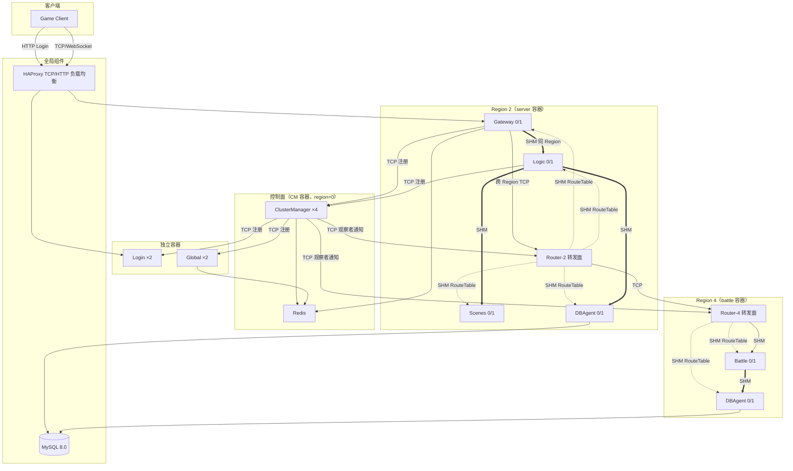
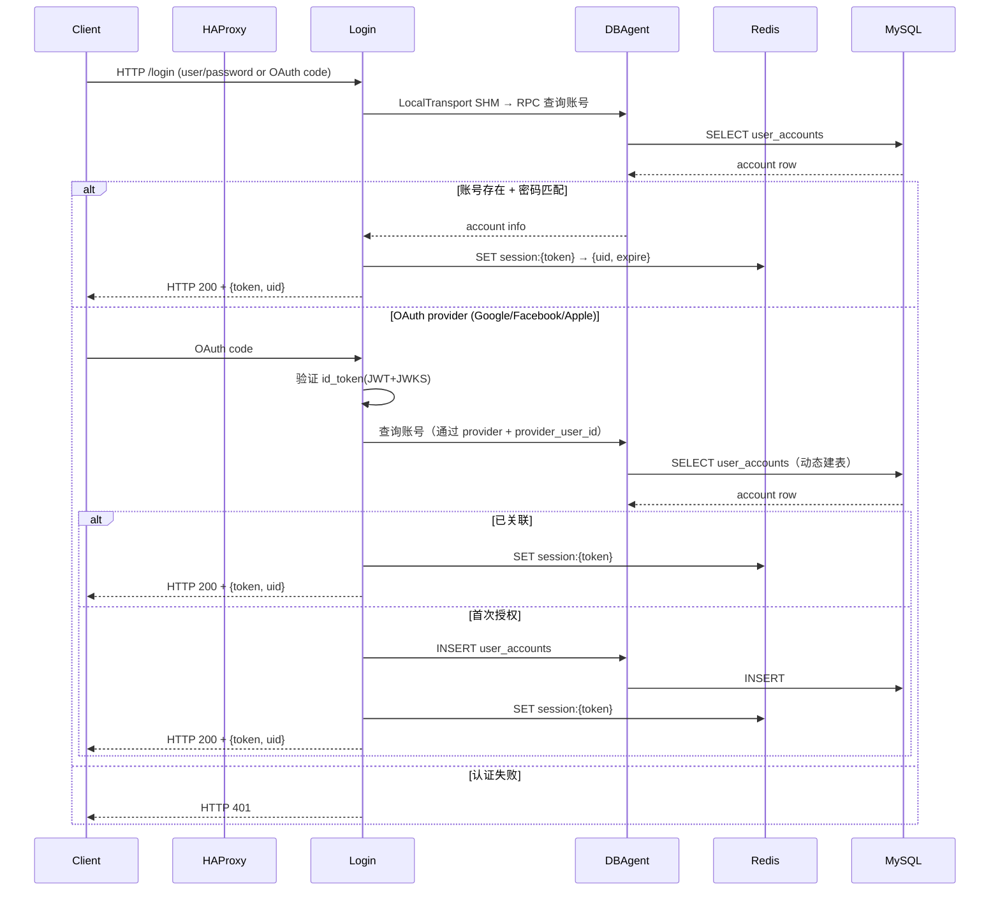
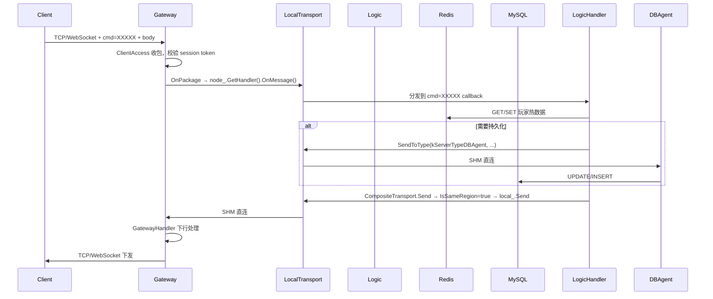
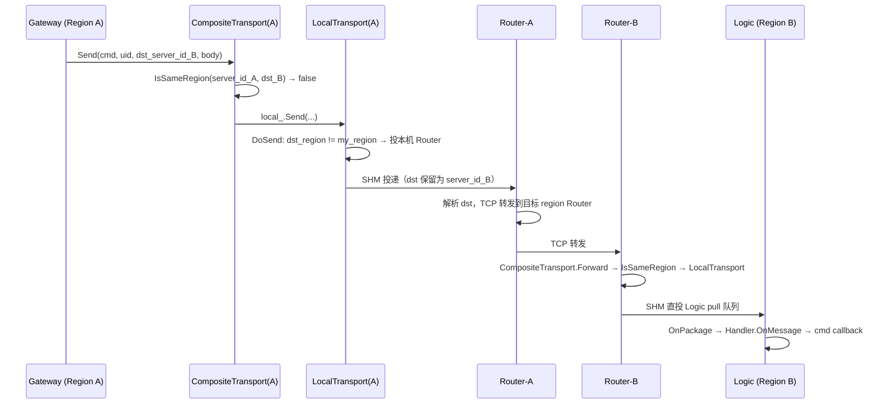
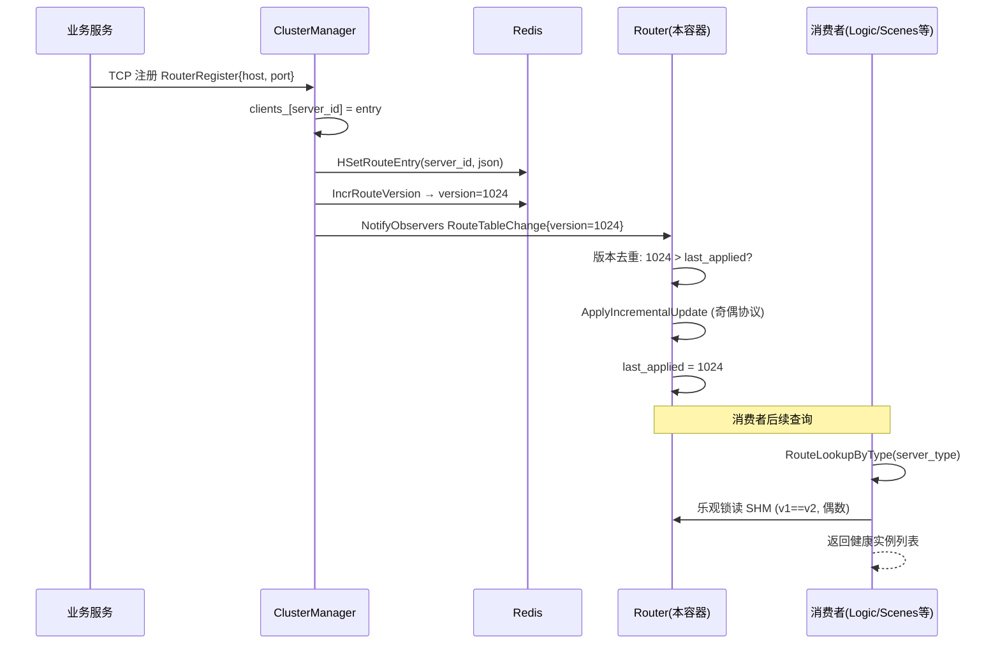
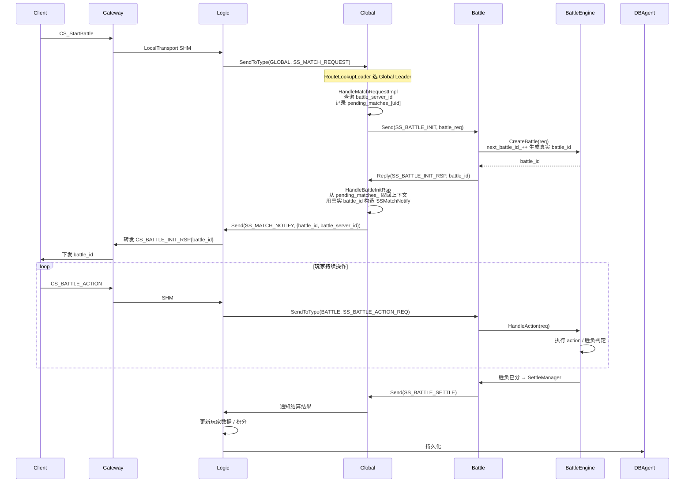

# 分布式游戏服务器集群 —— 架构设计

本文档描述 NimbusCluster 分布式游戏服务器集群的总体架构、服务节点职责、通信模型、核心业务流程、数据存储与关键设计模式。面向框架维护者和业务服务开发者，重点阐述 **INode 中介者 + CompositeTransport 抽象层 + MessageHandler 流水线** 三大核心支柱，以及 **CM 控制面 + Router SHM 路由表** 的服务发现与分发机制。

## 目录

1. [项目定位与约束](#1-项目定位与约束)
2. [架构全景](#2-架构全景)
3. [服务节点详解](#3-服务节点详解)
4. [通信架构](#4-通信架构)
5. [服务发现与路由表分发](#5-服务发现与路由表分发)
6. [核心流程](#6-核心流程)
7. [数据存储设计](#7-数据存储设计)
8. [关键设计模式](#8-关键设计模式)
9. [部署架构](#9-部署架构)

---

## 1. 项目定位与约束

### 1.1 项目定位

NimbusCluster 是一个 **进程化微服务** 的 C++17 游戏服务器集群。框架将典型 MOBA / MMORPG 所需的能力拆分为 **9 种服务节点**，通过 `server_id` 高 16 位（Region）区分物理容器，在同 Region 内用 Boost.Interprocess 共享内存消息队列（ShmQueueRpc，MPSC DescriptorRing）实现亚毫秒级 IPC，跨 Region 由 LocalTransport 自动投递到本机 Router，经 Router TCP 转发到目标 Region。

**路由表分发**采用 CM（ClusterManager）控制面 → Router SHM 架构：CM 将注册信息写入 Redis（HSET + INCR 全局版本号），通过观察者模式 TCP 通知各 Region Router，Router 以奇偶协议更新本机 SHM 路由表，消费者通过 atomic 版本号乐观锁读取。

业务层通过 **INode 中介者 + CompositeTransport + MessageHandler** 三件套与底层通信完全解耦，业务服务开发者只需注册 cmd 处理器，无需关心底层走 SHM 还是 TCP。

### 1.2 主要技术约束

| 约束 | 说明 |
|------|------|
| C++17 单体仓库 | 所有服务共用一份 CMake 顶层，减少构建复杂度 |
| Boost.Asio 单线程 io_context | 每个服务实例 1 个 io_context，多实例并行，避免共享状态 |
| Protobuf + gRPC | 统一消息编码；gRPC 仅用于跨语言接口预留，内部 RPC 走 SHM/TCP |
| 共享内存文件命名 | 以 `server_id` 为 key，每个服务实例一组 SHMQ（1 pull + N push） |
| Redis + MySQL | Redis 做热数据/排行榜/路由表存储，MySQL 做持久化存储 |
| 9 种服务节点固定集 | ClusterManager / Router / Gateway / Login / DBAgent / Logic / Scenes / Global / Battle，由 `protocol::ServerType` 枚举统一管理 |
| ServerID 编码规则 | `uint32_t server_id = ((region << 16) & 0xFFFF0000) \| ((type << 8) & 0x0000FF00) \| (index & 0x000000FF)`；例：Region 2 + Logic(5) + index 0 = 0x00020500 |

### 1.3 通信架构概览

| 场景 | 协议/通道 | 说明 |
|------|-----------|------|
| 客户端 → Gateway | TCP / WebSocket | HAProxy 前置 TCP 负载均衡；Login 走 HTTP 重定向登录 |
| 服务 → 服务（同 region） | **SHM 消息队列**（ShmQueueRpc，MPSC DescriptorRing） | LocalTransport 直连目标服务的 pull 队列，无中间转发 |
| 服务 → 服务（跨 region） | **LocalTransport → 本机 Router SHM → TCP → 目标 region Router → SHM** | 业务无感自动路由：LocalTransport::DoSend 检测 dst_region != my_region 时自动投本机 Router |
| Gateway → Logic → DBAgent | SHM（同 Region） | 典型热路径，走 LocalTransport（同 Region SHM Queue） |
| 路由表分发 | **CM（Redis HSET+INCR）→ 观察者 TCP 通知 → Router → SHM 奇偶协议写入 → 消费者 atomic 乐观锁读取** | CM 是唯一权威源；Router 在每个容器更新本机 SHM；消费者通过 `RouteLookupByType`/`RouteLookupLeader` 读取 |
| Login → DBAgent | SHM（同 Region）或 TCP（跨 Region） | OAuth 三提供商账号校验 |
| Global → Battle | LocalTransport（跨 Region 经 Router） | 战斗匹配分配、结算通知 |

---

## 2. 架构全景

### 2.1 架构全景图



### 2.2 服务节点一览表

| # | 服务类型 | Proto 枚举 | 目录 | 二进制 | 部署 | 核心职责 |
|---|---------|-----------|------|--------|------|---------|
| 0 | **ClusterManager** | `CLUSTER_MANAGER = 9` | `clustermanager` | 独立进程，×4 | CM 容器（2 容器：cm-1 含 router+cm0,1；cm-2 含 cm2,3） | **控制面**：服务注册、心跳检测、Redis 路由表持久化（HSET+INCR version）、观察者通知（TCP 推送 RouteTableChange）；直接继承 TcpServer，不使用 ITransport 抽象 |
| 1 | **Router** | `ROUTER = 1` | `router` | 每 Region ×2 | 各容器 | **转发面 + SHM 路由表维护**：接收 CM 观察者通知 → SHM 奇偶协议更新路由表；跨 Region TCP 转发；脏状态检测与全量同步恢复；唯一使用 CompositeTransport 的服务 |
| 2 | Gateway | `GATEWAY = 2` | `gateway` | server 容器 ×2 | server | 玩家 TCP/WebSocket 接入、心跳、uid↔session 映射、CS 下行拦截器 |
| 3 | Login | `LOGIN = 3` | `login` | login 容器 ×2 | login | HTTP 注册/登录、OAuth 2.0（Google/Facebook/Apple）、token/session 分发 |
| 4 | DBAgent | `DB_AGENT = 4` | `dbagent` | server ×2 + battle ×2 + global ×2 + login ×2 | 各业务容器 | MySQL 访问代理、动态建表、读写 RPC |
| 5 | Logic | `LOGIC = 5` | `logic` | server 容器 ×2 | server | 玩家状态、会话验证、核心业务、GM 命令 |
| 6 | Scenes | `SCENES = 6` | `scenes` | server 容器 ×2 | server | 场景/地图/房间、位置同步 |
| 7 | Global | `GLOBAL = 7` | `global` | global 容器 ×2 | global | **全局协调**：在线统计、排行榜、全服广播、战斗匹配队列；Leader 顺位选举（`instance_id` 最小者） |
| 8 | Battle | `BATTLE = 8` | `battle` | battle 容器 ×2 | battle | 战斗引擎：BattleInstance、BattleRule、SettleManager、StatsManager |

### 2.3 部署拓扑

单台主机的典型部署：

```text
Host 1（CM 容器组，region=0）
├── clustermanager-1 容器
│   ├── Router          ×2   (转发面 + SHM 路由表，region=0)
│   └── ClusterManager  ×2   (cm 0, 1，控制面)
├── clustermanager-2 容器
│   └── ClusterManager  ×2   (cm 2, 3，控制面)
└── Redis

Host 2（login 容器，region=1）
├── Router          ×2   (转发面 + SHM 路由表)
├── Login           ×2
└── DBAgent         ×2

Host 3（server 容器，region=2）
├── Router          ×2   (转发面 + SHM 路由表)
├── DBAgent         ×2
├── Gateway         ×2
├── Scenes          ×2
└── Logic           ×2

Host 4（global 容器，region=3）
├── Router          ×2   (转发面 + SHM 路由表)
├── Global          ×2
└── DBAgent         ×2

Host 5（battle 容器，region=4）
├── Router          ×2   (转发面 + SHM 路由表)
├── DBAgent         ×2
└── Battle          ×2
```

Router 在每个容器中维护本机 SHM 路由表，同容器内所有业务进程通过 `ServiceBase::RouteLookupByType` / `RouteLookupLeader` 以乐观锁读取。

---

## 3. 服务节点详解

### 3.1 ClusterManager（CM，控制面，×4）

ClusterManager 是集群的 **唯一控制面**，负责服务注册、心跳检测、Redis 路由表持久化、观察者通知。CM 不转发任何业务数据包。

#### 核心职责

| 维度 | 职责 |
|------|------|
| **服务注册** | 业务进程 TCP 连接 CM 后发送 `RouterRegister{host, port}`，CM 从 `package->src()` 获取 `server_id`，推导 `server_type`/`region`/`instance_id`，存入 `clients_` 内存表 |
| **Redis 持久化** | `redis.HSetRouteEntry(pb_entry)` + `version = redis.IncrRouteVersion()`，保证多 CM 实例幂等（HSET 覆盖写同一 key） |
| **心跳检测** | CM 通过层级时间轮（TimerWheel）管理心跳超时（15s 超时，3s 探测间隔）；超时标记 `healthy=false`，触发 Redis 更新 + 观察者通知 |
| **观察者通知** | CM 维护 `observers_`（所有 Region 的 Router 连接），注册变更时通过 TCP 推送 `RouteTableChange{event_type, server_id, ..., version}` |
| **全量同步** | Router 启动注册为观察者或 SHM 脏状态检测时，CM 回复 `RouteTableFullSync`（含当前所有注册条目和版本号） |
| **启动恢复** | CM 启动时 `HGetAllRouteEntries` 从 Redis 全量恢复 `clients_` 内存表 |

#### CM → Router 通知流程

```text
CM 收到注册（OnRegister）：
  1. clients_[server_id] = entry                 // 内存表
  2. redis.HSetRouteEntry(pb_entry)              // Redis 持久化
  3. version = redis.IncrRouteVersion()          // 全局递增版本号
  4. NotifyObservers("register", entry, version) // TCP 推送所有 Router

CM 检测断线（OnDisconnect）：
  1. entry = clients_[server_id]                  // 保存
  2. clients_.erase(server_id)                    // 清理内存
  3. redis.HDelRouteEntry(server_id)             // 清理 Redis
  4. version = redis.IncrRouteVersion()
  5. NotifyObservers("unregister", entry, version)
```

#### 幂等性保障（两层模型）

| 层 | 职责 | 机制 | 效果 |
|----|------|------|------|
| CM → Redis | 多 CM 同时写不冲突 | `HSET` 覆盖写 + `INCR` 原子递增 | 全局有序 |
| Router 去重 | 过滤 4 个 CM 重复通知 | `notify_version > last_applied` 比较 | 1 次注册仅 1 次 SHM 更新 |

### 3.2 Router（转发面 + SHM 路由表维护，每 Region ×2）

Router 在每个容器中承担双重职责：跨 Region TCP 转发 + 本机 SHM 路由表维护。

| 维度 | 职责 |
|------|------|
| **转发面** | 接收本 Region 业务进程通过 SHM 投递的跨 Region 消息，解析 `msg.head.dst`，TCP 转发到目标 Region 的 Router |
| **观察者** | 连接所有 4 个 CM 实例，接收 `RouteTableChange` 通知；版本去重（`notify_version > last_applied`）后增量/全量更新 SHM |
| **SHM 写入（奇偶协议）** | `version++(奇数) → 修改数据 → version++(偶数)`；消费者读到奇数版本时重试，防止读到半写数据 |
| **脏状态恢复** | `OnTick()` 检测 SHM version 持续奇数超过阈值 → `SendRawToCM(FULL_SYNC_REQ)` → CM 回复 `RouteTableFullSync` → 全量重建 |
| **RouterAccess** | TCP Server：接收本 Region 业务进程注册连接（绑定 `server_id → connection`）和 CM 观察者通知；非注册/非通知包走 `transport.Forward` |

#### SHM 路由表结构（Router 写入，消费者只读）

```cpp
// src/common/shm/shm_routetable.h
static constexpr uint32_t kMaxRouteEntries = 256;
static constexpr uint64_t kRouteTableMagic = 0x4E424D535F52544CULL;

#pragma pack(push, 1)
struct RouteTableHeader {
    uint64_t magic = kRouteTableMagic;           // 魔数校验
    ipc::shm::ShmAtomic<uint64_t> version{0};    // 乐观锁版本号（奇数=写入中）
    uint32_t capacity = kMaxRouteEntries;        // 256
    uint32_t entry_count = 0;
    uint64_t last_full_update_ms = 0;
    uint8_t reserved[96] = {};
};  // 128 bytes

struct RouteEntryShm {                        // 固定 88 字节
    uint32_t server_id;
    uint32_t server_type;
    char host[64];                             // 固定长度，无指针
    uint32_t port;
    uint32_t region;
    uint32_t instance_id;
    uint8_t healthy;
    uint8_t reserved[3];
};
#pragma pack(pop)
```

### 3.3 Gateway

Gateway 是玩家接入网关，同时支持 **TCP** 和 **WebSocket** 两种客户端接入方式。

| 项 | 内容 |
|----|------|
| 继承 | `GatewayService : public ServiceBase` |
| ITransport | `LocalTransport`（同 region SHM 直连 + 跨 region 自动投本机 Router） |
| IMessageHandler | `GatewayHandler`（继承 `MessageHandler`） |
| 客户端接入 | `ClientAccess`（TCP 长连接）+ `WebSocketAccess`（WebSocket，独立 IClientAccess 实现） |
| 职责 | uid↔session 映射、心跳超时踢人、CS 下行拦截（GM 命令过滤） |
| CS 下行 | GatewayHandler 直接调用 `SendToClient`，经过 GatewayService 的 ClientAccess/WebSocketAccess 下发 |

### 3.4 Login

Login 提供 HTTP 登录注册 + OAuth 2.0 第三方认证。

| 项 | 内容 |
|----|------|
| 继承 | `LoginService : public ServiceBase` |
| ITransport | `LocalTransport` |
| IMessageHandler | `LoginHandler` |
| HTTP | 内嵌 HttpServer，路由 `/register`、`/login`、`/oauth/google`、`/oauth/facebook`、`/oauth/apple` |
| OAuth | 授权码模式 + JWT 验证；id_token 验签（JWKS endpoint） |
| 数据持久化 | 经 LocalTransport → SHM → DBAgent |
| Token | 签发 JWT access_token + Redis 中 session 记录 |

### 3.5 DBAgent

DBAgent 是 MySQL 统一访问代理，业务服务 **绝不应** 直接持有 mysql-connector 连接。

| 项 | 内容 |
|----|------|
| 继承 | `DBAgentService : public ServiceBase` |
| ITransport | `LocalTransport` |
| IMessageHandler | `DBAgentHandler` |
| MySQL | 每实例一个连接池；动态建表（从 protobuf Descriptor 读取表结构，`GenerateCreateTableSQL` 自动生成 DDL） |
| 数据表 | protobuf message 名即表名；DBAgent 启动时自动 `CREATE TABLE IF NOT EXISTS`（`CreateTable` 方法） |
| 请求分发 | 按 cmd 分发到 DB 请求处理器；写操作串行化保证单请求完整性 |

### 3.6 Logic

Logic 是业务核心。

| 项 | 内容 |
|----|------|
| 继承 | `LogicService : public ServiceBase` |
| ITransport | `LocalTransport` |
| IMessageHandler | `LogicHandler` |
| 玩家数据 | Redis 热数据 + DBAgent 持久化 |
| OnBefore 钩子 | `LogicHandler::OnBefore` 中打开玩家共享内存块（`UserInfoWrap::ShmUserInfo`，`SharedMemory<DBUserInfo>`），为同进程同 region 跨 Logic 实例共享 |
| GM 命令 | cmd 表中注册 GM 命令处理器，支持在线 GM 指令下发 |
| CS 路径 | Gateway → LocalTransport(SHM) → LogicHandler → OnMessage → 业务处理 → LocalTransport.Send(SHM) → Gateway → ClientAccess |

### 3.7 Battle

Battle 是独立战斗服务，承担完整的战斗引擎职责。

| 项 | 内容 |
|----|------|
| 继承 | `BattleService : public ServiceBase` |
| ITransport | `LocalTransport` |
| IMessageHandler | `BattleHandler` |
| 核心组件 | `BattleEngine`（工厂 + 注册表）、`BattleInstance`（单场战斗状态）、`BattleRule`（胜负判定规则）、`SettleManager`（结算分发）、`StatsManager`（战报统计） |
| BattleEngine | `CreateBattle(SSBattleInitReq)` → 生成 `battle_id`（`next_battle_id_++`）→ 注册到 map；`OnTick()` 推进所有活跃 BattleInstance；`HandleAction(SSBattleActionReq)` 处理玩家操作 |
| 跨语言接口 | `battlerpc.proto` 预留 gRPC 接口，供 Python / Go 活动服调用 |
| 容器 | 独立 `docker/battle/docker-compose.yml`；启动脚本 `start_battle.sh`：router×2 + dbagent×2 + battle×2 |
| 与 Logic 协作 | 战斗开始由 Logic → Global（匹配分配）→ Battle 发起；结算结果 Battle → Global → Logic |

### 3.8 Scenes

| 项 | 内容 |
|----|------|
| 继承 | `ScenesService : public ServiceBase` |
| ITransport | `LocalTransport` |
| IMessageHandler | `ScenesHandler` |
| 职责 | 场景、地图、房间/大厅、位置广播；gRPC 预留 Scenes 跨语言接口 |

### 3.9 Global —— 固定顺位 Leader 选举

Global 是集群的 **全局协调层**，负责在线统计、排行榜、全服广播、战斗匹配队列。Global 采用 **Leader-Follower 多实例部署**，**Leader 由 SHM 路由表中的 `instance_id` 最小者担任**——纯确定性计算，无需分布式锁、无需选举动作、无需 host_id/rank 配置。

#### 核心职责

| 项 | 内容 |
|----|------|
| 继承 | `GlobalService : public ServiceBase` |
| ITransport | `LocalTransport`（同 Region SHM + 跨 Region 经本机 Router） |
| IMessageHandler | `GlobalHandler` |
| 在线统计 | 各 Logic 实例上报在线人数，Global 汇总 |
| 排行榜 | `HandleRankingUpdate` / `HandleGetRanking` |
| 全服广播 | `HandleBroadcastRequest` / `HandleGetBroadcast` |
| GM 命令 | `HandleGmCommand` |
| 战斗匹配队列 | `HandleMatchRequest` / `HandleBattleInitRsp`（匹配队列管理 + Battle 实例分配） |
| Battle 结果通知 | `HandleBattleInitRsp`（接收 Battle 初始化响应，回 `SS_MATCH_NOTIFY` 给 Logic） |

#### Leader 选举：固定顺位计算（`instance_id` 最小者）

**Leader 不是"选"出来的，而是"算"出来的。** 所有进程（Global 自身、Logic、Scenes、Gateway）通过 `INode::RouteLookupLeader(server_type)` 从 SHM 路由表读取同类型所有健康实例，取 `instance_id` 最小者为 Leader：

```cpp
// ServiceBase::RouteLookupLeader（src/common/foundation/servicebase.cpp）
uint32_t ServiceBase::RouteLookupLeader(uint32_t server_type) const
{
    // 乐观锁读取 SHM
    for (int retry = 0; retry < 3; ++retry)
    {
        uint64_t v1 = hdr->version.load(std::memory_order_acquire);
        if (v1 & 1) continue;  // 奇数：写入中，重试

        // 收集所有 healthy 的指定类型实例，取 instance_id 最小者
        uint32_t leader_id = 0;
        uint32_t min_instance_id = 0xFFFFFFFF;
        for (uint32_t i = 0; i < count; ++i)
        {
            if (entries[i].server_type == server_type && entries[i].healthy)
            {
                uint32_t instance_id = entries[i].instance_id;
                if (instance_id < min_instance_id)
                {
                    min_instance_id = instance_id;
                    leader_id = entries[i].server_id;
                }
            }
        }

        uint64_t v2 = hdr->version.load(std::memory_order_acquire);
        if (v1 == v2) return leader_id;  // 版本稳定，数据一致
    }
    return 0;
}
```

#### Global 自身 Leader 判断

```cpp
// GlobalService（src/global/globalservice.cpp）
bool GlobalService::IsLeader() const
{
    uint32_t leader_id = RouteLookupLeader(kGlobalServerType);
    return (leader_id == server_id());
}

void GlobalService::UpdateLeaderState()
{
    bool is_leader = IsLeader();
    if (is_leader && !was_leader_) {
        // BECOME LEADER：执行接管逻辑
    } else if (!is_leader && was_leader_) {
        // LOST LEADER：执行退让逻辑
    }
    was_leader_ = is_leader;
}

int GlobalService::OnTick()
{
    UpdateLeaderState();  // 每 tick 检查 Leader 状态
    return 0;
}
```

#### 消息路由

**发送方（Logic/Scenes → Global）**：`LocalTransport::SendToType` / `AsyncRequest` 对 `GLOBAL` 类型特殊处理，使用 `RouteLookupLeader` 选择 Leader 实例：

```cpp
// localtransport.cpp
if (server_type == protocol::ServerType::GLOBAL)
    dst_server_id = node_.RouteLookupLeader(server_type);
else
    dst_server_id = node_.RouteLookupByType(server_type);
```

**接收方（Global Follower 拒绝请求）**：`GlobalHandler::OnBefore` 检查 Leader 状态，非 Leader 回复 `RESULT_NOT_LEADER`：

```cpp
bool GlobalHandler::OnBefore(UserId uid, const ipc::PackagePtr& pkg)
{
    auto* global_service = dynamic_cast<GlobalService*>(&node_);
    if (!global_service->IsLeader())
    {
        ReplyFail(pkg->cmd(), uid, pkg->src(), protocol::RESULT_NOT_LEADER, pkg->request_id());
        return false;  // 阻止业务 handler 执行
    }
    return true;
}
```

#### 故障切换

```
Global-1 (instance_id=0, Leader) 宕机
  │
  ├─ CM 心跳超时（15s）→ healthy=false
  ├─ CM HSetRouteEntry + IncrRouteVersion → NotifyObservers("health_change")
  ├─ Router-3 收到通知 → SHM 更新：Global-1 healthy=0
  │
  ├─ Logic 下次 SendToType(GLOBAL) → RouteLookupLeader
  │     └─ 读 SHM → [Global-1 healthy=0, Global-2 healthy=1]
  │     └─ instance_id 最小 → Global-2 (instance_id=1) 成为新 Leader
  │
  └─ Global-2 自身 OnTick → UpdateLeaderState()
        └─ IsLeader() = true → BECOME LEADER
```

**切换延迟**：CM 心跳超时（15s）+ Router SHM 更新（毫秒级）+ 消费者下次读取（即时）+ Global 自身检测（下一个 OnTick）。总延迟主要由 CM 心跳超时决定。

#### Global 与 Battle 的职责分工

| 服务 | 职责 | 说明 |
|------|------|------|
| **Global（全局协调）** | 匹配队列、排行榜、全服广播、Battle 实例分配 | 决策"谁和谁打"以及"在哪台 Battle 上打"；Leader-Follower 保证协调层高可用 |
| **Battle（战斗引擎）** | 执行具体战斗逻辑 | BattleInstance + BattleRule + SettleManager + StatsManager |

---

## 4. 通信架构

### 4.1 总体分层

```text
┌─────────────────────────────────────────────────┐
│              业务 Handler 层                     │
│   LogicHandler / GatewayHandler / BattleHandler  │
│   继承 MessageHandler，注册 cmd → callback 表    │
└────────────────────┬────────────────────────────┘
                     │ IMessageHandler::OnMessage()
┌────────────────────▼────────────────────────────┐
│           INode 中介者                           │
│   GetTransport() / GetHandler() 单一数据源       │
│   RouteLookupByType / RouteLookupLeader          │
└────────────────────┬────────────────────────────┘
                     │ ITransport 统一接口
┌────────────────────▼────────────────────────────┐
│          LocalTransport（业务服务主传输层）       │
│   同 region：SHM 直连目标服务                     │
│   跨 region：SHM 投本机 Router → TCP 转发        │
│   SendToType/AsyncRequest 对 GLOBAL 走 Leader │
└────────────────────┬────────────────────────────┘
                     │
        ┌────────────┴────────────┐
        │                         │
┌───────▼────────┐      ┌────────▼───────────┐
│  ShmQueueRpc   │      │  本机 Router        │
│  MPSC Descriptor│      │  (CompositeTransport)│
│  同 region 直投 │      │  local_=SHM +      │
│                │      │  remote_=TCP→Router │
└────────────────┘      └─────────────────────┘

注：Router 是唯一使用 CompositeTransport 的服务，承担跨 Region TCP 转发职责。
    所有业务服务（Gateway/Login/DBAgent/Logic/Scenes/Global/Battle）统一使用
    LocalTransport，跨 Region 消息自动经本机 Router 转发，业务无感。
```

### 4.2 ITransport 接口

```cpp
class ITransport
{
public:
    virtual ~ITransport() = default;

    // 初始化
    virtual bool Init(const protoconf::ServerItem& cfg) = 0;

    // 向 CM 发送注册包（仅 CM 模式 RemoteTransport 实现）
    virtual int SendRegister() { return -1; }

    // CM 模式专用：向所有 CM 连接发送原始 Package
    virtual int SendRawToCM(const ipc::Package&) { return -1; }

    // 发送侧（6 方法）
    virtual int Send(uint16_t cmd, UserId uid, uint32_t dst_server_id,
                     const google::protobuf::Message& body,
                     int result, uint64_t request_id = 0) = 0;

    virtual int SendToType(uint16_t cmd, UserId uid, uint32_t server_type,
                           const google::protobuf::Message& body,
                           int result = 0, uint64_t request_id = 0) = 0;

    virtual int Broadcast(uint16_t cmd, UserId uid, uint32_t server_type,
                          const google::protobuf::Message& msg) = 0;

    [[deprecated("Use Send() instead.")]]
    virtual int Forward(const protocol::Payload& payload) = 0;

    using ReplyCallback = std::function<void(const ipc::PackagePtr&)>;

    virtual int AsyncRequest(uint16_t cmd, UserId uid, uint32_t server_type,
                             const google::protobuf::Message& body,
                             ReplyCallback cb) = 0;

    // Gateway-only：下行包给玩家 ClientAccess
    virtual int SendToClient(const ipc::Package&) { return -1; }

    // 收包入口
    virtual int OnPackage(const ipc::PackagePtr& pkg) = 0;

    // 基础设施访问
    virtual boost::asio::io_context& io_context() = 0;
    virtual uint32_t server_id() const = 0;

    // Sink 便捷方法（默认委托给 Send 侧）
    virtual int ReplyToSender(uint16_t cmd, UserId uid, uint32_t src_server_id,
                              const google::protobuf::Message& body,
                              int result, uint64_t request_id = 0);
    virtual int PublishToType(uint16_t cmd, UserId uid, uint32_t server_type,
                              const google::protobuf::Message& body,
                              int result = 0, uint64_t request_id = 0);
    virtual int BroadcastType(uint16_t cmd, UserId uid, uint32_t server_type,
                              const google::protobuf::Message& msg);
};
```

### 4.3 LocalTransport —— 业务服务主传输层与路由决策点

**LocalTransport 是所有业务服务（Gateway/Login/DBAgent/Logic/Scenes/Global/Battle）的统一传输层**，也是业务侧的**唯一路由决策点**。它内部封装了同 Region 直投和跨 Region 经 Router 转发两种路径，业务代码完全无需感知底层走 SHM 还是 TCP。

LocalTransport 通过 `node_.RouteLookupByType` / `RouteLookupLeader`（SHM 路由表）查询目标实例，确保目标健康后再发送；SHM 不可用时降级到静态 ConfigManage。LocalTransport 本身不做健康检查——健康过滤在 INode 的 RouteLookup 层完成。

```cpp
// 核心路由决策：LocalTransport::DoSend
int LocalTransport::DoSend(const protocol::Payload& msg)
{
    auto dst_server_id = msg.head().dst();
    auto my_region  = server_id() >> 16;
    auto dst_region = dst_server_id >> 16;

    uint32_t topic_server_id = dst_server_id;
    if (my_region != dst_region)
    {
        // 跨 region：投本机 Router（由 Router 转发到目标 region）
        auto router_id = node_.RouteLookupLocalRouter();
        topic_server_id = router_id;
    }
    // msg.head().dst() 始终是最终目标服务 server_id（Router 据此路由）
    return rpc_.SendMessage(std::to_string(topic_server_id), package);
}

// RegionStrategy：server_id 高 16 位
static inline uint32_t RegionOf(uint32_t sid)   { return sid >> 16; }
static inline bool IsSameRegion(uint32_t a, uint32_t b) { return RegionOf(a) == RegionOf(b); }
```

#### SendToType 路由策略

```cpp
int LocalTransport::SendToType(uint16_t cmd, UserId uid, uint32_t server_type,
                               const google::protobuf::Message& body,
                               int result, uint64_t request_id)
{
    // GLOBAL 类型走 Leader 顺位查询，其他类型走普通查询
    uint32_t dst_server_id = 0;
    if (server_type == protocol::ServerType::GLOBAL)
        dst_server_id = node_.RouteLookupLeader(server_type);
    else
        dst_server_id = node_.RouteLookupByType(server_type);

    // SHM 不可用时降级到静态 ConfigManage
    if (dst_server_id == 0)
        dst_server_id = ConfigManageSingle::instance().GetServerIdByUidAndType(uid, server_type);
    if (dst_server_id == 0) return -1;

    return Send(cmd, uid, dst_server_id, body, result, request_id);
}
```

**关键点**：LocalTransport 在把目标传给 ShmQueueRpc **之前**，已经通过 SHM 路由表确保了目标是健康的。ShmQueueRpc 是**纯工具库**，不关心健康状态，只负责"把包发出去"。

### 4.4 CompositeTransport —— Router 专用转发层

CompositeTransport 仅由 **Router** 使用，承担跨 Region TCP 转发职责。它内含 `local_`（LocalTransport，接收本 Region 业务进程的跨 Region 消息）和 `remote_`（RemoteTransport，TCP 转发到目标 Region Router）两个成员。

```cpp
// Router 的 CompositeTransport::Forward 路由决策
int CompositeTransport::Forward(const protocol::Payload& msg)
{
    uint32_t const dst = msg.head().dst();
    if (IsSameRegion(server_id(), dst))
        return local_->Forward(msg);   // 同 region：SHM 直连
    return remote_->Forward(msg);      // 跨 region：TCP → 目标 Router
}
```

Router 的 CompositeTransport 在 `Init()` 中初始化 LocalTransport 和 RemoteTransport：
- `local_`：监听本 Region 业务进程投递到 Router 的跨 Region 消息
- `remote_`：连接所有其他 Region 的 Router，按 `dst_region` 路由 TCP 转发

### 4.4 LocalTransport —— 同 Region SHM 工具库

LocalTransport 是**纯工具库**，负责基于 POSIX 共享内存的同 Region 进程间通信。它不做健康检查、不做路由决策、不感知对端死活——所有健康过滤在 INode 的 RouteLookup 层已经完成。

| 能力 | 说明 |
|------|------|
| Pull 队列 | `InitPullQueue()` 打开本实例 pull 队列，`ShmQueueRpc<MpscDescriptorRing>` 1 pull N push 模式 |
| Push 队列 | `InitPushQueues()` 为同 region 所有目标服务类型打开 push 队列（从静态配置获取） |
| 收包线程 | SHM 收包线程 → `OnShmPackage` → `io_context().dispatch(OnPackage)` → `INode.GetHandler().OnMessage()` 分发 |
| 发包 | `Forward(msg)` / `Send()` 直接写入对应 push 队列；同 region 直投目标，跨 region 投本机 Router |
| Leader 路由 | `SendToType`/`AsyncRequest` 对 `GLOBAL` 类型使用 `RouteLookupLeader` |

```cpp
// 跨 region 自动投递到本机 Router
int LocalTransport::DoSend(const protocol::Payload& msg)
{
    auto dst_server_id = msg.head().dst();
    auto my_region = server_id() >> 16;
    auto dst_region = dst_server_id >> 16;

    uint32_t topic_server_id = dst_server_id;
    if (my_region != dst_region)
    {
        // 跨 region：投本机 Router（由 Router 转发到目标 region）
        auto router_id = node_.RouteLookupLocalRouter();
        topic_server_id = router_id;
    }
    // msg.head().dst() 始终是最终目标服务 server_id（Router 据此路由）
    return rpc_.SendMessage(std::to_string(topic_server_id), package);
}
```

### 4.5 RemoteTransport —— 跨 Region TCP → Router 工具库

RemoteTransport 是**纯工具库**，负责跨 Region TCP 消息发送。

| 能力 | 说明 |
|------|------|
| 连接策略 | 连接所有 Router 实例（从配置获取）；Router 模式下不连 CM、跳过本 region Router |
| 发包 | `Forward(msg)` / `Send()`：将消息原样发给目标 Router，Router 查 SHM 路由表转发 |
| 收包 | `TcpDispatcher` 收包 → `node_.GetHandler().OnMessage(pkg)` 经 INode 中介者分发到业务 Handler |
| CM 模式 | `MakeCMTransport` 创建的 RemoteTransport 专门用于控制面：连接所有 CM，发送注册包/心跳，`SendRawToCM` 发送控制面消息 |
| 异步请求 | 跨 region 的 `AsyncRequest` 使用 `ShmQueueRpc` 内部 `pending_` map（request_id 关联回调 + 超时清理） |

### 4.6 AsyncRequest 回调匹配机制

`AsyncRequest` 允许发送方发送请求后不阻塞，等对方回复时自动触发回调。请求-回复匹配由 **ShmQueueRpc** 内部管理，无需独立 Correlator 类。

```cpp
// 核心机制在 ShmQueueRpc::AsyncRequest 内部
int ShmQueueRpc::AsyncRequest(uint16_t cmd, UserId uid, uint32_t dst,
                              const google::protobuf::Message& body,
                              ITransport::ReplyCallback cb)
{
    uint64_t request_id = GetNextRequestId();  // 单调递增
    pending_[request_id] = cb;                  // 注册回调

    // 发送带 request_id 的 Package
    PackagePtr pkg = BuildPackage(cmd, uid, dst, body, 0, request_id);
    SendRaw(pkg);
    return 0;
}

// 收包侧：检测 request_id != 0 → 触发 pending callback
void ShmQueueRpc::OnDispatch(const PackagePtr& pkg)
{
    if (pkg->request_id() != 0)
    {
        auto it = pending_.find(pkg->request_id());
        if (it != pending_.end())
        {
            it->second(pkg);                // 执行业务回调
            pending_.erase(it);             // 释放
        }
        return;  // 回包不进入 handler 流程
    }
    // 普通请求走 handler
    ...
}
```

**请求-回复流程**：
```
Logic SendToType(GLOBAL, body, cb)
  → ShmQueueRpc::AsyncRequest
        → request_id=42, pending_[42]=<weak_ptr to ServiceBase>
        → 发送 Package{request_id=42}
  → Global Handler 处理
  → Global ReplyToSender(..., <response>, result=0, request_id=42)
  → ShmQueueRpc::OnDispatch 检测 request_id!=0
        → pending_[42] 回调触发 ✓
        → pending_[42] 释放
```

**关键设计**：
- request_id 由 ShmQueueRpc 内部单调递增生成，不暴露给上层
- pending_ 回调存储使用 `weak_ptr`，防止 Service 销毁后悬空
- 回包（request_id != 0）不进入 MessageHandler 流水线，直接匹配回调

### 4.7 消息编码

统一使用 Protobuf：
- `protocol/message.proto` 定义外层消息 `Payload`（head + body）
- `protocol/commonenum.proto` 定义 cmd 枚举和 `ServerType` 枚举
- 各业务目录下 `*.proto` 定义业务消息（如 `battle/battlerpc.proto`）

### 4.8 gRPC 预留

- `battlerpc.proto`：Battle 预留跨语言 gRPC 接口（Python / Go 活动服接入）
- `globalrpc.proto` / `logicrpc.proto` / `scenesrpc.proto`：各服务预留跨语言 gRPC 接口
- gRPC 仅用于跨语言接口预留；内部 RPC 走 SHM / TCP

---

## 5. 服务发现与路由表分发

### 5.1 总体架构

路由表分发采用 **CM 控制面 → Redis 持久化 → 观察者通知 → Router SHM 奇偶协议 → 消费者乐观锁读取** 的分层架构：

```
服务注册/反注册/健康变化
  │
  ▼
CM（控制面，×4）
  ├─ clients_ 内存表（server_id → RouterEntry）
  ├─ Redis HSetRouteEntry / HDelRouteEntry
  ├─ Redis IncrRouteVersion（全局单调递增版本号）
  └─ NotifyObservers(RouteTableChange{version})
         │
         ▼ TCP 通知
各 Region 的 Router
  ├─ 版本去重：notify_version > last_applied
  ├─ 增量更新 SHM（register/unregister/health_change）
  │   或全量重建 SHM（FullSync）
  ├─ SHM 奇偶协议：version++(奇) → 写入 → version++(偶)
  └─ last_applied = notify_version
         │
         ▼ SHM 路由表（同容器只读）
消费者（Logic/Scenes/Gateway/Battle/Global）
  └─ ServiceBase::RouteLookupByType / RouteLookupLeader
     乐观锁读取（load(acquire) × 2 + compare，奇数重试）
```

### 5.2 注册协议

服务通过 `SS_MSG_CMD_ROUTER_REGISTER` 向 CM 上报：

| 字段 | 类型 | 来源 | 说明 |
|------|------|------|------|
| `server_id` | uint32 | `PackageHead.src` | 服务唯一标识 |
| `host` | string | `RouterRegister.host` | 服务监听地址 |
| `port` | uint32 | `RouterRegister.port` | 服务监听端口 |

**CM 派生字段**（从 server_id 解码）：

| 字段 | 推导方式 |
|------|---------|
| `server_type` | `(server_id >> 8) & 0xFF` |
| `region` | `server_id >> 16` |
| `instance_id` | `server_id & 0xFF` |

### 5.3 观察者协议

Router 连接 CM 后发送 `SS_MSG_CMD_ROUTER_OBSERVER_REGISTER`，CM 将其加入 `observers_` 列表。注册变更时 CM 推送：

```protobuf
message RouteTableChange {
    string event_type = 1;   // "register" / "unregister" / "health_change"
    uint32 server_id = 2;
    uint32 server_type = 3;
    string host = 4;
    uint32 port = 5;
    uint32 region = 6;
    uint32 instance_id = 7;
    bool healthy = 8;
    uint64 version = 9;     // Redis 全局版本号（Router 去重用）
}
```

### 5.4 Router SHM 更新（奇偶协议）

Router 收到通知后，通过奇偶协议保证 SHM 写入的原子性：

```cpp
void ApplyIncrementalUpdate(const RouteEntryShm& entry, const std::string& event_type)
{
    uint64_t write_ver = header->version.load(acquire);
    header->version.store(write_ver + 1, release);  // 奇数：写入中

    if (event_type == "unregister") {
        // swap-pop 删除条目
    } else {  // register / health_change
        // 新增或更新条目
    }

    header->version.store(write_ver + 2, release);  // 偶数：完成
}
```

**版本去重**：`notify_version <= last_applied` 时跳过，防止 4 个 CM 重复通知导致多次 SHM 更新。

### 5.5 消费者乐观锁读取

消费者通过 `ServiceBase::RouteLookupByType` / `RouteLookupLeader` 读取 SHM 路由表：

```cpp
for (int retry = 0; retry < 3; ++retry)
{
    uint64_t v1 = hdr->version.load(acquire);
    if (v1 & 1) continue;  // 奇数：脏状态，重试

    // 读取 entries...

    uint64_t v2 = hdr->version.load(acquire);
    if (v1 == v2) return result;  // 版本稳定，数据一致
}
return 0;  // 重试失败，返回 0（调用方降级到静态配置）
```

### 5.6 脏状态检测与全量恢复

Router 的 `OnTick()` 周期性检测 SHM version 是否持续为奇数（写入中崩溃）：

```
RouterService::OnTick:
  每 kDirtyDetectIntervalTicks 次 tick:
    if (RouterObserver::IsShmDirty()):   // version % 2 == 1
      dirty_detect_count_++
      if (dirty_detect_count_ >= kDirtyDetectThreshold):
        SendFullSyncReq()                 // SendRawToCM(FULL_SYNC_REQ)
        dirty_detect_count_ = 0

CM::OnFullSyncReq:
  验证请求者为已注册观察者
  SendFullSync(RouteTableFullSync{entries, version})

RouterObserver::OnRouteTableFullSync:
  WriteFullTable(entries)   // 全量重建 SHM
  last_applied = sync.version
```

### 5.7 幂等性保障（四层模型）

| 层 | 职责 | 组件 | 机制 | 效果 |
|----|------|------|------|------|
| **第 1 层：CM 全局幂等** | 多 CM 多主机同时写不冲突 | CM → Redis | `HSET` 覆盖写同一 server_id + `INCR` 原子递增 | 全局有序、数据一致 |
| **第 2 层：Router 去重幂等** | 过滤 4 个 CM 的重复通知 | Router | `notify_version > last_applied` 比较 | 1 次注册仅 1 次 SHM 更新 |
| 第 3 层：SHM 写入幂等 | 单次 SHM 写不产生脏数据 | Router → SHM | 奇偶协议：奇数=写入中，偶数=稳定 | 崩溃后消费者不读脏数据 |
| 第 4 层：SHM 读取幂等 | 消费者读一致性 | 消费者 → SHM | `load(acquire) × 2 + compare`，奇数重试 | 版本稳定才消费 |

---

## 6. 核心流程

### 6.1 登录流程



### 6.2 游戏消息流程



### 6.3 跨 Region 通信流程



### 6.4 服务发现与路由表分发流程



### 6.5 Battle 战斗流程



**Battle 分配关键约束**：
- Global 必须等待 `SS_BATTLE_INIT_RSP` 返回真实 `battle_id` 后，才发送 `SS_MATCH_NOTIFY` 给 Logic
- `SS_MATCH_NOTIFY` 使用 Battle 返回的真实 `battle_id`，而非 uid
- `gateway_id` 必须设置为玩家实际所在 Gateway 的 server_id（从 UserInfo SHM 获取），确保客户端能收到战斗推送

---

## 7. 数据存储设计

### 7.1 MySQL（8.0）

| 表 | 说明 |
|----|------|
| `user_accounts` | 主账号：user_id, username/email, password_hash, salt, created_at |
| `user_profiles` | 玩家资料：user_id → 昵称、头像、创建时间 |
| `user_heroes` | 玩家已拥有英雄列表 |
| `user_items` | 玩家背包/道具 |
| `battle_history` | 战报记录：battle_id, player_ids, winner, scores, duration |
| `global_state` | **Global 主从兜底 checkpoint**：Leader 周期性持久化 match_queue / match_state；Follower 恢复的最后兜底 |

动态建表机制：DBAgent 启动时扫描 protobuf Descriptor，从 `GenerateCreateTableSQL` 自动生成 DDL，若 MySQL 中不存在则自动 `CREATE TABLE IF NOT EXISTS`（`CreateTable` 方法）。表名由 protobuf message 名决定。

### 7.2 Redis

| Key 模式 | 用途 |
|----------|------|
| `session:{token}` | Login 写入，Logic 验证，TTL 默认 24h |
| `player:{uid}` | 玩家热数据（JSON），Logic 读写 |
| `leaderboard:{game_mode}` | `ZSET`，Global/Battle 更新，排行榜查询 |
| `router:servers` | **CM 维护的在线服务注册表 + 唯一健康权威源**（Hash: server_id → JSON）；Router 通过观察者通知 + 全量同步获取 |
| `router:version` | **全局单调递增版本号**（Int，INCR）；CM 每次注册变更 INCR，Router 用于去重 |
| `global:state_snapshot:{version}` | **Global 状态周期快照**（Hash，带递增 version 字段用于乐观锁校验）；新 Leader 接管时取最高版本快照 |

### 7.3 共享内存（Boost.Interprocess）

- 每个服务实例一组 SHM：pull 队列 + N push 队列（按同 region 目标服务类型）
- 路由表 SHM：`nimbus_route_table`（256KB，由 Router 创建，同容器业务进程只读）
- 队列文件命名：`/dev/shm/dgsf/{server_id}_{role}`（`ipc::shm::MpscDescriptorRing`）
- 生产 Docker Compose 设置 `shm_size: 512m`，Battle 容器 `shm_size: 256m`
- **一个容器 = 一台主机**：容器 MUST have independent IPC namespaces；NEVER use `ipc: host`

---

## 8. 关键设计模式

### 8.1 INode 中介者模式（核心抽象）

所有业务 Service 继承 `ServiceBase`（继承 `INode`），提供统一访问点：

```cpp
class INode
{
public:
    virtual ~INode() = default;
    virtual bool Init(const protoconf::ServerItem& cfg) = 0;
    virtual int  OnTick() { return 0; }
    virtual ITransport&      GetTransport() const = 0;
    virtual IMessageHandler& GetHandler()   const = 0;
    constexpr uint32_t server_id() const { return server_id_; }
    boost::asio::io_context& io_context() { return io_context_; }

    // SHM 路由表查询
    virtual uint32_t RouteLookupByType(uint32_t server_type) const { return 0; }
    virtual uint32_t RouteLookupLocalRouter() const { return 0; }
    virtual uint32_t RouteLookupLeader(uint32_t server_type) const { return 0; }
};
```

好处：
- CompositeTransport / LocalTransport / RemoteTransport / MessageHandler 全部通过 `node_` 拿到 server_id、io_context、handler，**消除所有重复状态**
- 业务 Service（GatewayService / BattleService / LoginService ...）只需在 `Init()` 中创建 transport_ + handler_ 并双向注入
- Router 作为集群转发面，同样纳入 ServiceBase 体系

### 8.2 ITransport —— Facade + Strategy + Composite

| 模式 | 体现代码 |
|------|---------|
| Facade | `CompositeTransport` 提供 `Send / SendToType / Broadcast / Forward / AsyncRequest` 统一接口 |
| Strategy | IsSameRegion 运行时决定走 LocalTransport（SHM）还是 RemoteTransport（TCP→Router） |
| Composite | CompositeTransport 内含 local_ 和 remote_ 两个 ITransport 成员，对调用者透明 |

CompositeTransport 的 Forward 路由决策是核心设计点。

### 8.3 IMessageHandler —— 6 步流水线 + 注册表

```cpp
class IMessageHandler
{
public:
    virtual int OnMessage(const PackagePtr& pkg) = 0;
    virtual void RegisterHandler(uint16_t cmd, CmdCallback cb) = 0;
    virtual bool OnBefore(UserId uid, const PackagePtr& pkg) { return true; }
    virtual void OnAfter(int ret, const PackagePtr& pkg) {}
};
```

MessageHandler::OnMessage 内部 6 步流水线：

1. **pkg 空检查**
2. **request_id 匹配**：若 `pkg->request_id() != 0`，触发 `ShmQueueRpc` 的 pending callback 并返回（回包不走 handler）
3. **cmd 查表**：`handlers_.find(cmd)`
4. **ParseFromArray**：反序列化 Payload
5. **OnBefore()** → 虚钩子（LogicHandler 打开玩家 SHM；GlobalHandler 检查 Leader）
6. **业务 handler** → 调用 callback → **OnAfter()** → 虚钩子

### 8.4 Singleton 体系

框架中大量使用 Singleton，这些是**进程级**单例，在 `Init()` 阶段创建，生命周期覆盖整个进程：

| 单例 | 职责 |
|------|------|
| `ApplicationSingle` | 主事件循环管理，Run() 阻塞 |
| `ConfigManageSingle` | 本地 + 远程配置加载 |
| `RedisWrapSingle` | Redis 连接池（redis-plus-plus） |
| `LogManageSingle` | glog 初始化 |

### 8.5 Adapter —— RemoteTransport 封装 RpcClient

RemoteTransport 作为底层 TCP 连接（`RpcClient`）和 `ITransport` 接口之间的 Adapter，暴露统一接口，让业务代码无需感知底层是 SHM 还是 TCP。

`RemoteTransport` **不再继承 `ConnectionPool`**，而是内部持有 `RpcClient` 列表（`RpcClient` 继承 `ipc::net::TcpClient`），按目标 region 维护连接映射（`router_by_region_`）。`RpcClient` 负责单连接的 RPC 匹配、超时、断连清理；未匹配的转发包通过 `OnUnhandledPackage` 桥接到 `RemoteTransport::OnPackage`，最终经 `node_.GetHandler()` 分发。RemoteTransport 将 `Send`/`Forward` 调用按 `dst_region` 路由到对应的 `RpcClient` 连接发送。

### 8.6 Bridge —— Service（GatewayService / BattleService / LoginService）

`ServiceBase` 作为所有业务 Service 的基类，只提供通用基础设施：

- **控制面传输**（`cm_transport_`）：`InitCMTransport()` 创建 `RemoteTransport`（`ClusterManager` 模式），负责向 CM 注册、TCP 层心跳保活；
- **SHM 路由表查询**：`RouteLookupByType()` / `RouteLookupLeader()` 等，只读访问同容器 Router 维护的共享内存路由表。

各业务 Service（如 `GatewayService`、`LogicService`）继承 `ServiceBase` 后，在自身的 `Init()` 中**自行创建业务传输层**（如 `CompositeTransport` = `LocalTransport` + `RemoteTransport`），并装配 `IMessageHandler`。`ServiceBase` 不持有通用 `transport_`，业务通信行为由子类自行决定。Service 层作为 **Bridge**：连接"业务层"和"通信基础设施层"，双方独立演进。

---

## 9. 部署架构

### 9.1 容器化部署结构

| 文件 | 用途 |
|------|------|
| `docker/clustermanager/docker-compose.yml` | **ClusterManager ×4**（控制面） |
| `docker/router/` — 各业务容器内含 router | **Router**（每容器 ×2，转发面 + SHM 路由表） |
| `docker/global/docker-compose.yml` | **Global ×2**（匹配、队列、协调） |
| `docker/login/docker-compose.yml` | Login ×2 |
| `docker/server/docker-compose.yml` | DBAgent×2 + Gateway×2 + Scenes×2 + Logic×2（含内嵌 Redis + MySQL） |
| `docker/battle/docker-compose.yml` | DBAgent×2 + Battle×2 |
| `docker/container/haproxy/docker-compose.yml` | HAProxy 前置 |
| `docker/container/db/redis/docker-compose.yml` | 独立 Redis（生产） |
| `docker/container/db/mysql/docker-compose.yml` | 独立 MySQL（生产） |

> **TODO**：Kubernetes 部署方案（kustomize + StatefulSet）尚未实现，当前仅支持 Docker Compose。

### 9.2 启动顺序（生产）

`docker/docker-compose-prod-up.sh` 严格按以下顺序启动：

1. Shared DB（Redis → MySQL，各自依赖 `healthy` check）
2. **ClusterManager**（需要最早可用：服务注册发现 + 路由表同步，其他服务启动必须注册到 CM）
3. **各容器 Router**（创建 SHM 路由表，业务进程启动时读取）
4. **Global**（依赖 Router + Redis，注册为服务并拉取配置）
5. Login（独立服务集群）
6. Server（DBAgent 必须先于 Gateway/Scenes/Logic 启动，避免 SHM Pool 竞争）
7. Battle（独立容器，DBAgent 同样先启动）
8. HAProxy（最后，前置负载均衡）

> dbagent 必须先启动，避免 SHM Pool 竞争。

### 9.3 开发 vs 生产

| 维度 | 开发 | 生产 |
|------|------|------|
| 命令 | `bash docker-compose-up.sh` / `docker-compose-down.sh` | `DGSF_IMAGE=... sh docker-compose-prod-up.sh` / `sh docker-compose-prod-down.sh` |
| 镜像 | 本地 `build/` 编译 + volume mount 进容器 | `docker pull` GHCR 镜像 |
| 数据库 | server compose 内嵌 Redis + MySQL 容器 | container/db 独立 Redis + MySQL |
| HAProxy | ❌ 未启用 | ✅ 启用 |
| shm_size | 512m（server）/ 256m（battle） | 同开发 |

### 9.4 关键部署约束

- **一个容器 = 一台主机**：容器即主机，无需"模拟"概念；容器 MUST have independent IPC namespaces
- **NEVER use `ipc: host`**：共享 `/dev/shm` 会导致 SHM 队列消费者冲突
- **SHM 消息队列仅用于同容器（同主机）IPC**：跨容器通信走 TCP/Router
- `shm_size` 控制容器私有 `/dev/shm` 大小（默认 64MB 太小，使用 256m+）
- `region` 字段标识主机/容器：
  - region=0: CM 容器（clustermanager ×4 + router）
  - region=1: login 容器（login ×2 + dbagent ×2 + router）
  - region=2: server 容器（gateway ×2 + logic ×2 + scenes ×2 + dbagent ×2 + router）
  - region=3: global 容器（global ×2 + dbagent ×2 + router）
  - region=4: battle 容器（battle ×2 + router）
  - region=5,6...: 额外主机
- Server ID 编码：`(region << 16) | (type << 8) | index` — 不同 regions 永不冲突